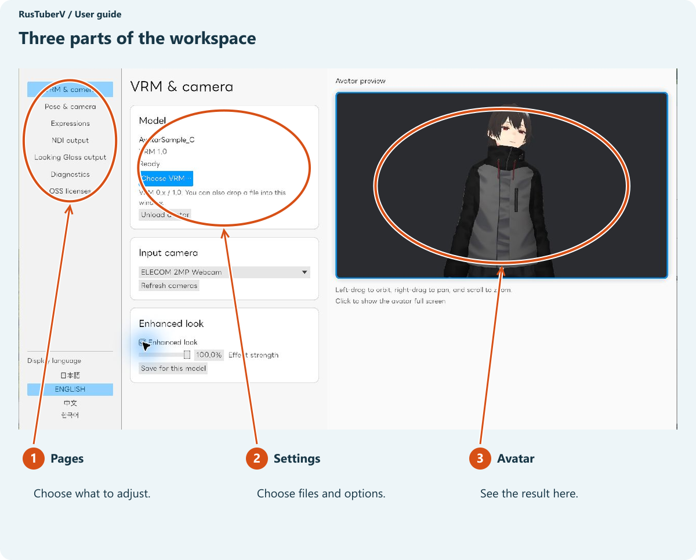

# RusTuberV

[日本語](README.md) · **English** · [简体中文](README.zh-CN.md) · [한국어](README.ko.md)

RusTuberV is a desktop app that animates a VRM avatar using your webcam. It follows your face and hand movements, sends avatar video to OBS through NDI® or Spout2, and supports Looking Glass displays.

## Download

| Download | Platform |
| --- | --- |
| [Windows](https://github.com/matsuvr/RusTuberV/releases/latest) | Windows x64 |
| [Mac](https://github.com/matsuvr/RusTuberV/releases/latest) | Apple Silicon, macOS 14 or later |

Distribution ZIPs include the inference models, required runtimes, and user guides.

## Get started

Prepare an avatar `.vrm` file and a webcam. A built-in camera works too.

On Windows, extract the entire ZIP and double-click `RusTuberV.exe` inside the extracted folder. Keep all bundled files together.

On Mac, extract the ZIP, move `RusTuberV.app` to Applications, and open it. If macOS requests approval on first launch, open System Settings → Privacy & Security → Open Anyway to allow the app.

1. Click **Choose VRM…**, select your avatar, and review its usage terms.
2. Select your webcam under **Input camera**.
3. Face the camera and try blinking, turning your head, and moving your hands.

The [English user guide](manual/en/README.md) covers framing, expressions, and sending video to OBS.

## Features

- VRM 0.x / 1.0 import
- Avatar rendering using the materials and expressions stored in the VRM
- Tracking of the face, blinks, gaze, mouth, upper body, arms, and hands
- Neutral-pose and arm calibration, mirroring, and framing controls
- Keyboard expression switching and per-model key bindings
- Transparent avatar video over NDI
- [Transparent Spout2 output to OBS on the same Windows PC](manual/SPOUT2.md#english)
- Looking Glass device discovery and output through Looking Glass Bridge
- Japanese, English, Simplified Chinese, and Korean UI

## Show your avatar in OBS

Open **NDI & Spout2 output** and use the start and stop buttons for each transport. The size, position, and angle you set in the preview apply to the transparent avatar video. Configure your microphone in OBS for your voice.

| Transport | Destination | OBS setup and instructions |
| --- | --- | --- |
| Spout2 | OBS on the same Windows PC | Install OBS Spout2 plugin and set Spout2 Capture's Composite Mode to Premultiplied Alpha. [Spout2 guide](manual/SPOUT2.md#english) |
| NDI | OBS on the same Windows or Mac computer, or another computer on the same network | Install DistroAV and its required NDI Runtime. [NDI guide](manual/en/README.md#send-with-ndi-windows-and-mac) |

## User guides

[日本語](manual/ja/README.md) · [English](manual/en/README.md) · [简体中文](manual/zh-CN/README.md) · [한국어](manual/ko/README.md)

Looking Glass output uses Looking Glass Bridge. See [Show the avatar on Looking Glass](manual/en/README.md#show-the-avatar-on-looking-glass) for device selection and output controls.

## Source code

The [build guide](tools/BUILDING.md) covers development setup and building from source.

## License

The project code is available under the [MIT License](LICENSE). See [THIRD_PARTY_NOTICES.md](THIRD_PARTY_NOTICES.md) for the licenses of dependencies, fonts, and inference models.

Use avatars and streaming assets according to their respective owners' terms.

NDI® is a registered trademark of Vizrt NDI AB.
