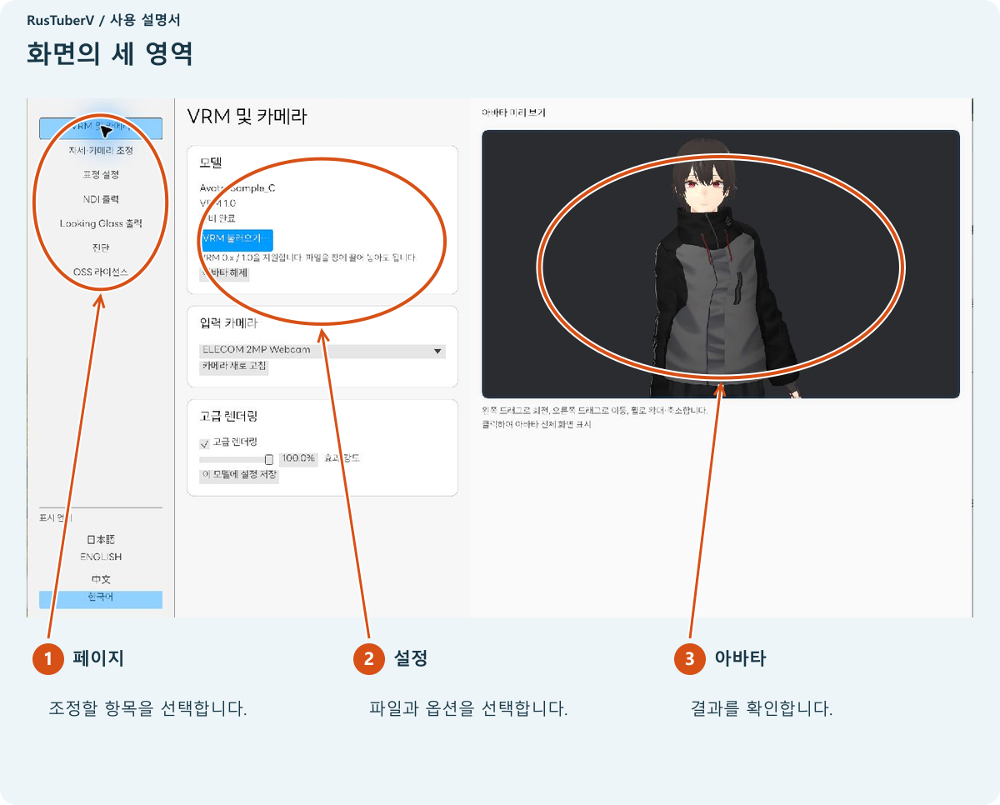

# RusTuberV

[日本語](README.md) · [English](README.en.md) · [简体中文](README.zh-CN.md) · **한국어**

RusTuberV는 웹캠으로 VRM 아바타를 움직이는 데스크톱 앱입니다. 얼굴과 손의 움직임을 아바타에 반영하고 NDI®와 Spout2로 OBS에 영상을 보내며 Looking Glass에도 표시할 수 있습니다.

## 다운로드

| 다운로드 | 실행 환경 |
| --- | --- |
| [Windows 버전](https://github.com/matsuvr/RusTuberV/releases/latest) | Windows x64 |
| [Mac 버전](https://github.com/matsuvr/RusTuberV/releases/latest) | Apple Silicon, macOS 14 이상 |

배포 ZIP에는 추론 모델, 필요한 런타임과 사용 설명서가 포함되어 있습니다.

## 시작하기

아바타의 `.vrm` 파일과 웹캠을 준비하세요. 컴퓨터 내장 카메라도 사용할 수 있습니다.

Windows에서는 ZIP 전체를 압축 해제한 뒤 폴더 안의 `RusTuberV.exe`를 더블 클릭하세요. 동봉된 파일은 함께 보관하세요.

Mac에서는 ZIP을 압축 해제하고 `RusTuberV.app`을 응용 프로그램 폴더로 옮겨 실행하세요. 처음 실행할 때 macOS에서 확인을 요청하면 시스템 설정 → 개인정보 보호 및 보안의 앱 실행 허용 항목을 선택하세요.

1. **VRM 불러오기…**를 눌러 아바타를 선택하고 이용 조건을 확인합니다.
2. **입력 카메라**에서 사용할 웹캠을 선택합니다.
3. 카메라를 바라보고 눈 깜빡임, 얼굴 방향과 손의 움직임을 확인합니다.

[한국어 사용 설명서](manual/ko/README.md)에서 구도, 표정 조정과 OBS 출력을 설명합니다.

## 주요 기능

- VRM 0.x / 1.0 불러오기
- VRM에 저장된 머티리얼과 표정으로 아바타 표시
- 얼굴, 눈 깜빡임, 시선, 입, 상체, 팔과 손 추적
- 중립 자세와 팔 보정, 좌우 반전과 구도 조정
- 키보드 표정 전환과 모델별 키 할당
- NDI를 통한 투명 배경 아바타 영상 전송
- [Spout2로 같은 Windows PC의 OBS에 투명 배경 영상 전송](manual/SPOUT2.md#한국어)
- Looking Glass Bridge를 통한 기기 검색과 출력
- 일본어, 영어, 중국어 간체와 한국어 UI

## OBS에 표시

**NDI 및 Spout2 출력**을 열고 각 방식의 시작·중지 버튼으로 전송을 조작합니다. 미리 보기에서 조정한 크기, 위치와 방향은 투명 배경 아바타 영상에 반영됩니다. 목소리는 OBS에서 마이크를 설정합니다.

| 방식 | 수신 대상 | OBS 준비와 사용 방법 |
| --- | --- | --- |
| Spout2 | 같은 Windows PC의 OBS | OBS Spout2 plugin을 설치하고 Spout2 Capture의 Composite Mode를 Premultiplied Alpha로 설정합니다. [Spout2 설명서](manual/SPOUT2.md#한국어) |
| NDI | 같은 Windows 또는 Mac 컴퓨터, 또는 같은 네트워크의 다른 컴퓨터에 있는 OBS | DistroAV와 해당 NDI Runtime을 설치합니다. [NDI 설명서](manual/ko/README.md#ndi로-전송windowsmac) |

## 사용 설명서

[日本語](manual/ja/README.md) · [English](manual/en/README.md) · [简体中文](manual/zh-CN/README.md) · [한국어](manual/ko/README.md)

Looking Glass 출력에는 Looking Glass Bridge를 사용합니다. 기기 선택과 출력 방법은 [Looking Glass에 표시](manual/ko/README.md#looking-glass에-표시)를 참조하세요.

## 소스 코드

[빌드 가이드](tools/BUILDING.md)에서 개발 환경 준비와 소스 빌드 방법을 설명합니다.

## 라이선스

프로젝트 코드는 [MIT License](LICENSE)로 공개되어 있습니다. 의존 라이브러리, 글꼴과 추론 모델의 라이선스는 [THIRD_PARTY_NOTICES.md](THIRD_PARTY_NOTICES.md)를 확인하세요.

아바타와 방송 소재는 각 권리자가 정한 이용 조건에 따라 사용하세요.

NDI® is a registered trademark of Vizrt NDI AB.
