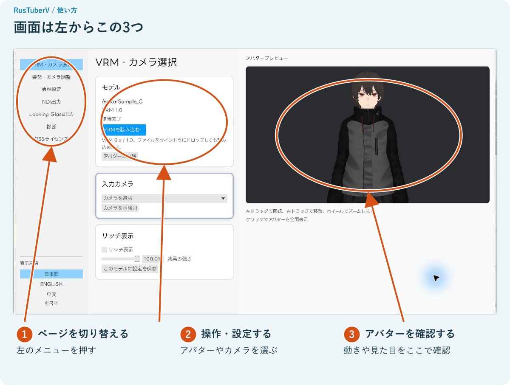

# RusTuberV

**日本語** · [English](README.en.md) · [简体中文](README.zh-CN.md) · [한국어](README.ko.md)

WebカメラでVRMアバターを動かすデスクトップアプリです。顔や手の動きをアバターに反映し、OBSへの映像出力やLooking Glassでの表示に使えます。

## ダウンロード

| ダウンロード | 対応環境 |
| --- | --- |
| [Windows版](https://github.com/matsuvr/RusTuberV/releases/tag/v0.2.1) | Windows x64 |
| [Mac版](https://github.com/matsuvr/RusTuberV/releases/tag/v0.2.2) | Apple Silicon、macOS 14以降 |

配布ZIPには、推論モデル、必要なランタイム、利用マニュアルを同梱しています。

## はじめる

使いたいアバターの`.vrm`ファイルとWebカメラを用意します。パソコン内蔵のカメラも使えます。

WindowsではZIPを「すべて展開」し、フォルダー内の`RusTuberV.exe`をダブルクリックします。同梱ファイルはまとめて置いてください。

MacではZIPを展開し、`RusTuberV.app`をアプリケーションフォルダーへ移動して起動します。初回起動時にmacOSの確認が表示された場合は、「システム設定」→「プライバシーとセキュリティ」→「このまま開く」から起動を許可してください。

1. 「VRMを読み込む…」からアバターを選び、モデルの利用条件を確認します。
2. 「入力カメラ」で使用するカメラを選びます。
3. カメラに顔を向け、まばたきや顔の向き、手の動きを試します。

画角や表情の調整、OBSへの出力は[日本語の利用マニュアル](manual/ja/README.md)で紹介しています。

## 主な機能

- VRM 0.x / 1.0の読み込み
- 顔、まばたき、視線、口、上半身・腕・手のトラッキング
- 中立姿勢と腕の校正、左右反転、画角調整
- キーボードによる表情切り替えとモデルごとのキー割り当て
- リッチ表示とモデルごとの設定保存
- NDI®による背景透過映像の送信
- Looking Glass Bridgeによる機器検出と出力
- 日本語、英語、中国語、韓国語のUI

## マニュアル

[日本語](manual/ja/README.md) · [English](manual/en/README.md) · [简体中文](manual/zh-CN/README.md) · [한국어](manual/ko/README.md)

Looking Glassへの出力にはLooking Glass Bridgeを使用します。機器の選択と出力方法は[Looking Glassに映す](manual/ja/README.md#looking-glassに映す)を参照してください。

## ソースコード

開発環境の準備やソースからのビルド方法は、[ビルド手順](tools/BUILDING.md)にまとめています。

## ライセンス

本プロジェクトのコードは[MIT License](LICENSE)で公開しています。依存ライブラリ、フォント、推論モデルのライセンスは[THIRD_PARTY_NOTICES.md](THIRD_PARTY_NOTICES.md)をご確認ください。

アバターや配信素材は、各権利者が定める利用条件に沿ってご利用ください。

NDI® is a registered trademark of Vizrt NDI AB.
