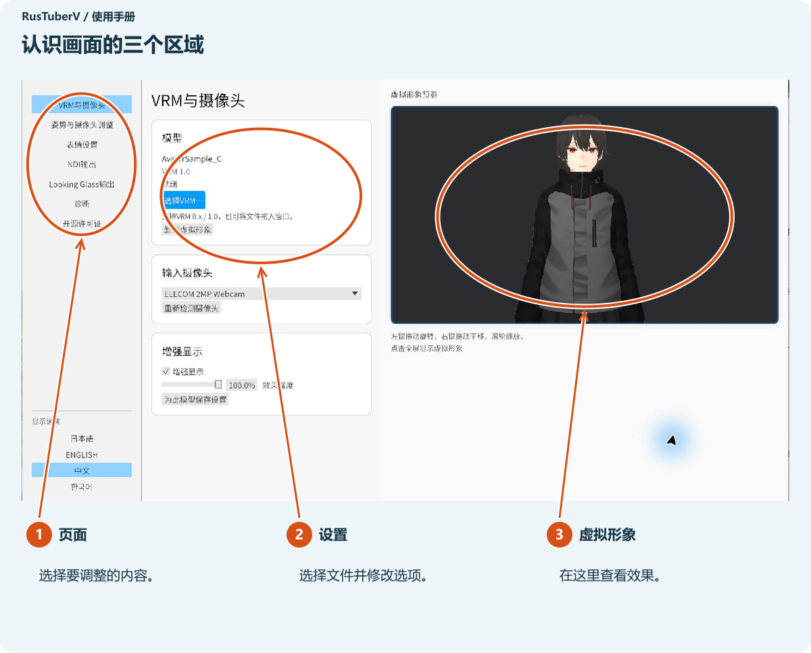

# RusTuberV

[日本語](README.md) · [English](README.en.md) · **简体中文** · [한국어](README.ko.md)

RusTuberV 是通过摄像头驱动 VRM 虚拟形象的桌面应用。它将脸部和手部动作反映到虚拟形象上，通过 NDI® 或 Spout2 向 OBS 发送视频，并支持 Looking Glass 显示设备。

## 下载

| 下载 | 运行环境 |
| --- | --- |
| [Windows版](https://github.com/matsuvr/RusTuberV/releases/latest) | Windows x64 |
| [Mac版](https://github.com/matsuvr/RusTuberV/releases/latest) | Apple Silicon、macOS 14及以上 |

发行 ZIP 包含推理模型、所需运行时和使用手册。

## 开始使用

准备好虚拟形象的 `.vrm` 文件和摄像头。电脑内置摄像头也可以使用。

在 Windows 上完整解压 ZIP，双击文件夹中的 `RusTuberV.exe`。请将所有附带文件放在一起。

在 Mac 上解压 ZIP，将 `RusTuberV.app` 移到“应用程序”文件夹并打开。首次启动时，如果 macOS 要求确认，请在“系统设置”→“隐私与安全性”→“仍要打开”中允许启动。

1. 点击“选择VRM…”，选择虚拟形象并确认使用条件。
2. 在“输入摄像头”中选择摄像头。
3. 面对摄像头，试着眨眼、转头和移动双手。

[简体中文使用手册](manual/zh-CN/README.md)介绍了构图、表情调整和 OBS 输出。

## 主要功能

- 加载 VRM 0.x / 1.0
- 使用 VRM 中保存的材质和表情显示虚拟形象
- 跟踪脸部、眨眼、视线、嘴部、上半身、手臂和手部
- 自然姿势与手臂校准、镜像和构图调整
- 键盘表情切换及按模型保存按键绑定
- 通过 NDI 发送透明背景虚拟形象视频
- [通过 Spout2 向同一台 Windows 电脑上的 OBS 发送透明背景视频](manual/SPOUT2.md#简体中文)
- 通过 Looking Glass Bridge 检测设备并输出
- 日语、英语、简体中文和韩语界面

## 在OBS中显示

打开“NDI与Spout2输出”，使用各自的开始和停止按钮控制发送。在预览中调整的大小、位置和角度会反映到透明背景视频中。声音通过 OBS 的麦克风设置输入。

| 方式 | 接收端 | OBS准备与操作 |
| --- | --- | --- |
| Spout2 | 同一台 Windows 电脑上的 OBS | 安装 OBS Spout2 plugin，将 Spout2 Capture 的 Composite Mode 设为 Premultiplied Alpha。[Spout2手册](manual/SPOUT2.md#简体中文) |
| NDI | 同一台 Windows 或 Mac 电脑，或同一网络中另一台电脑上的 OBS | 安装 DistroAV 及其所需的 NDI Runtime。[NDI手册](manual/zh-CN/README.md#通过ndi发送windowsmac) |

## 使用手册

[日本語](manual/ja/README.md) · [English](manual/en/README.md) · [简体中文](manual/zh-CN/README.md) · [한국어](manual/ko/README.md)

Looking Glass 输出使用 Looking Glass Bridge。设备选择与输出操作请参阅[输出到Looking Glass](manual/zh-CN/README.md#输出到looking-glass)。

## 源代码

[构建指南](tools/BUILDING.md)介绍了开发环境准备和源码构建方法。

## 许可证

项目代码以 [MIT License](LICENSE) 发布。依赖库、字体和推理模型的许可证请参阅 [THIRD_PARTY_NOTICES.md](THIRD_PARTY_NOTICES.md)。

虚拟形象和直播素材请按各权利人规定的条件使用。

NDI® is a registered trademark of Vizrt NDI AB.
