# RusTuberV User Guide

[日本語](../ja/README.md) · **English** · [简体中文](../zh-CN/README.md) · [한국어](../ko/README.md)

Talk, smile, and move your hands in front of your webcam. Bring your avatar to life and show it in OBS.

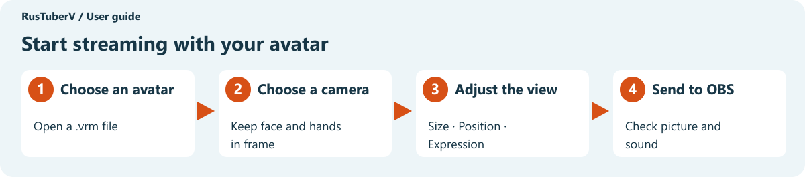

**[Get started](#get-started)** · **[Adjust the view](#adjust-the-view)** · **[Change expressions](#change-expressions)** · **[Show your avatar in OBS](#show-your-avatar-in-obs)** · **[Troubleshooting](#troubleshooting)**

## Get started

### What you need

| Item | What it does |
| --- | --- |
| The complete RusTuberV application folder | Displays your avatar |
| An avatar `.vrm` file | Your on-screen character. VRM 0.x and 1.0 are supported |
| A webcam | Captures your face and hands. A built-in camera works too |

For streaming or recording, install [OBS Studio](https://obsproject.com/) as well. You can try the avatar's movements in RusTuberV first.

### Open the application

On Windows, double-click **RusTuberV.exe** in the application folder. If you received a ZIP file, right-click it and choose **Extract All** before opening the app.

**Keep the folder's contents together.** Run RusTuberV.exe from that folder rather than moving it elsewhere.

Select **ENGLISH** in the language buttons at the bottom left to use the labels shown in this guide.

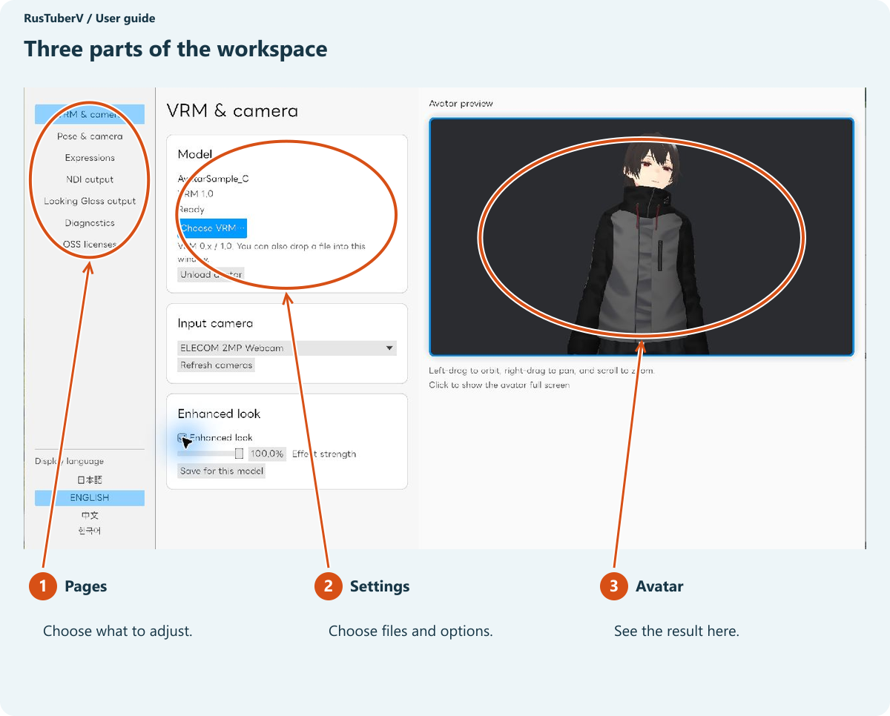

### 1. Choose an avatar

Click **Choose VRM…** and select the `.vrm` file you want to use.

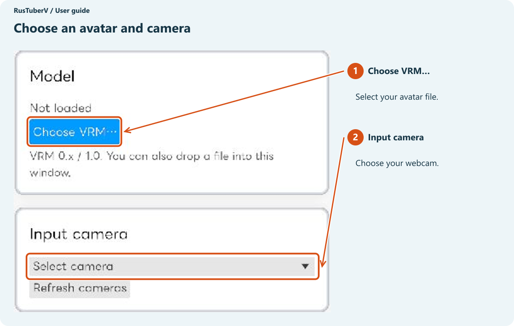

You can also drag the file into the app window.

When the license screen appears, scroll through its contents and review the usage terms. If your intended use is permitted, tick the checkbox at the bottom and click **Import**.

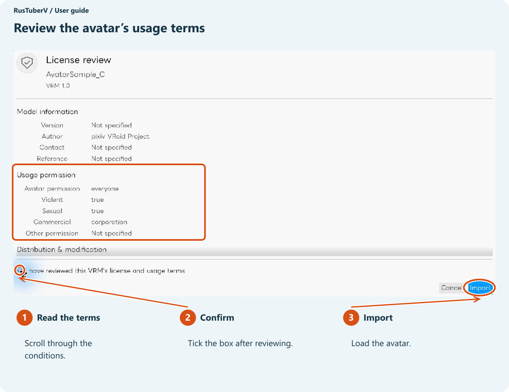

The avatar appears on the right. When the status reads **Ready**, loading is complete.

### 2. Select a camera

Open **VRM & camera** on the left and choose your webcam from **Input camera**. Camera names vary between computers.

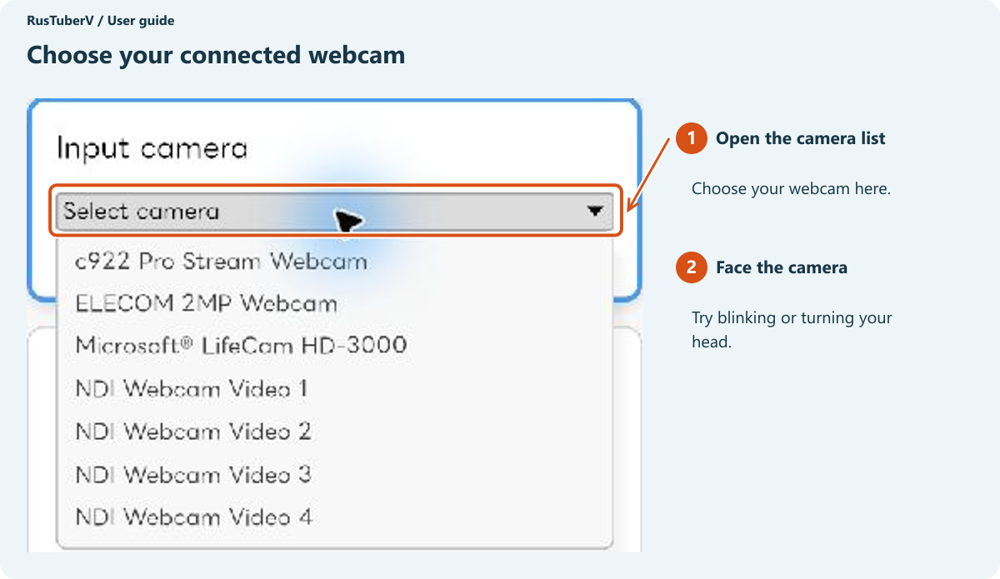

Face the camera and try blinking or turning your head. The avatar can move while the actual camera preview remains hidden.

**If your camera is missing, click Refresh cameras.** Use this after plugging in a camera too.

## Adjust the view

### Face the camera

Open **Pose & camera** on the left and face the camera with a relaxed expression. The first detected face automatically sets the reference direction.

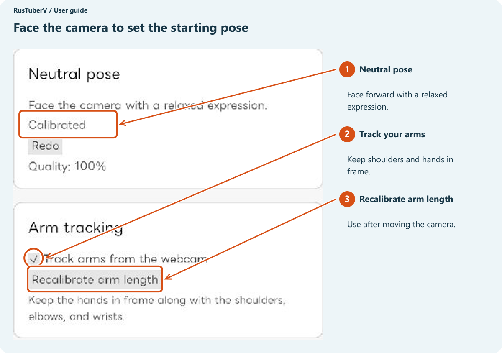

If your avatar tilts while you face forward, use **Neutral pose → Redo**. Keep your face in view while the app waits to detect it.

**To move your hands, keep your shoulders, elbows, wrists, and hands in frame.** Tick **Track arms from the webcam**. If arm movements no longer line up after moving the camera, click **Recalibrate arm length**.

### Change size, position, and angle

Use your mouse over the avatar image on the right.

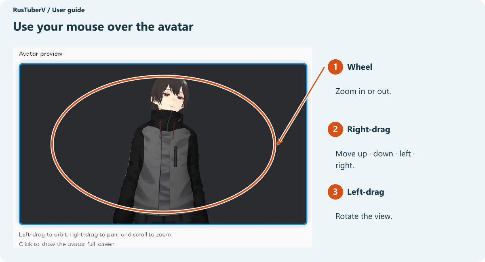

| What you want | Action |
| --- | --- |
| Make the avatar larger or smaller | Turn the mouse wheel |
| Move it up, down, left, or right | Hold the right mouse button and drag |
| View it from the side or at an angle | Hold the left mouse button and drag |
| Restore the original framing | Scroll down in Pose & camera and click Reset avatar framing |

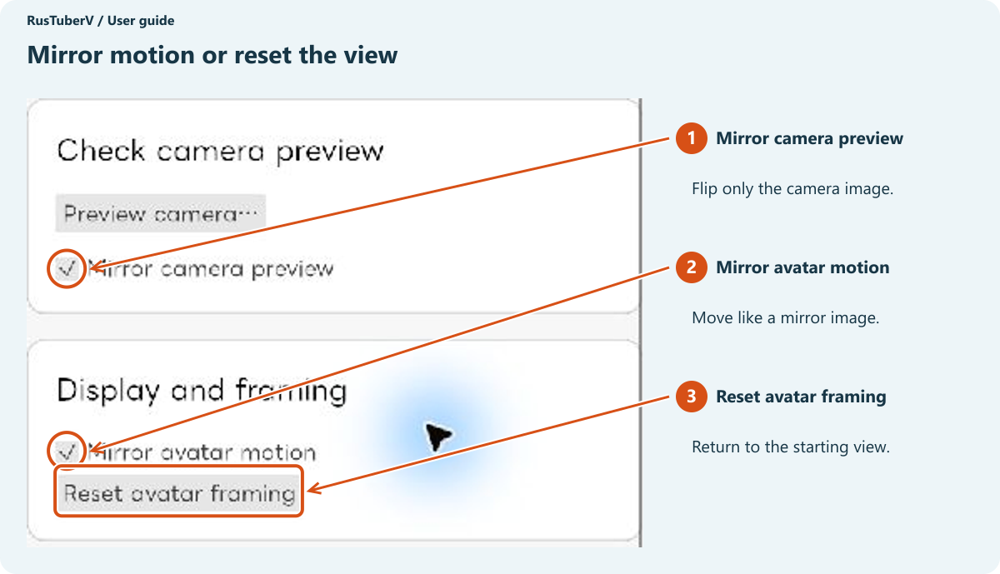

**Mirror avatar motion** makes the avatar move as though you were looking in a mirror. **Mirror camera preview** only flips the camera image used for checking your position.

### Show the avatar across the window

**Click once** on the avatar image to hide the settings and expand the avatar view. Click the blue button at the top right to return to the settings.

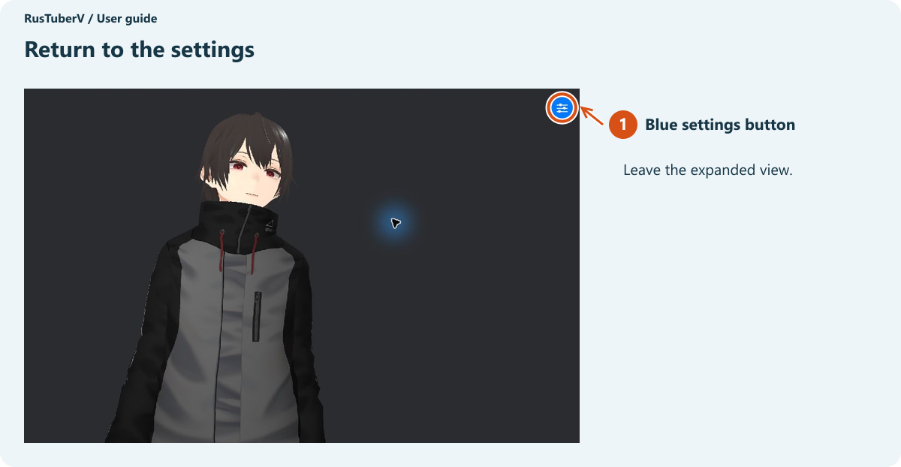

### Adjust the appearance

Tick **VRM & camera → Enhanced look** to change the lighting and outlines. Adjust **Effect strength** to your liking. Click **Save for this model** to reuse those settings when you load the same avatar.

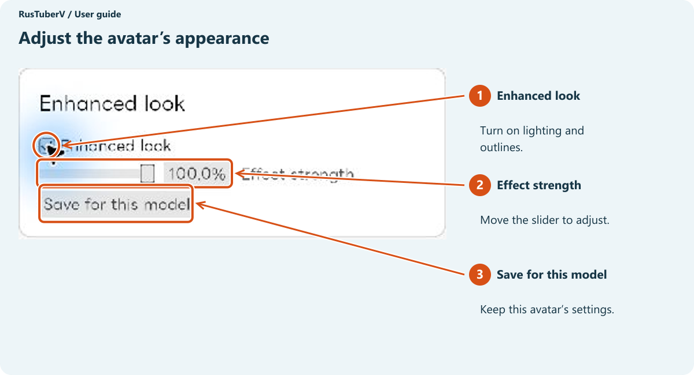

To adjust resting arm positions, use **Arm pose** in **Pose & camera**. **Arm drop** controls how far the arms are lowered and **Finger curl** controls finger bending. Move the sliders a little at a time and check the avatar on the right.

## Change expressions

Open **Expressions** on the left. Each key has its assigned expression shown beside it.

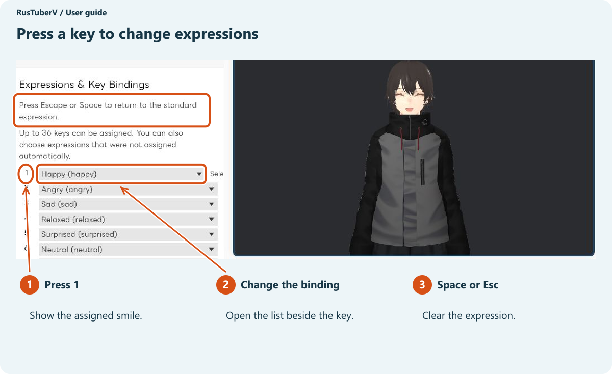

**Select the RusTuberV window before pressing a key.** Use the number keys on the top row of the keyboard.

| Action | Result |
| --- | --- |
| Press an assigned key | Select that expression |
| Press the same key again | Clear that expression |
| Press Space or Esc | Return to the standard expression |

Open the list beside a key to change its expression. Available expressions depend on the avatar. In this example, **1** selects a smile.

Bindings are saved for each avatar. Scroll to the bottom for **Clear Expression** and **Restore Default Bindings**.

## Show your avatar in OBS

NDI® sends your avatar video to OBS. See the [official NDI website](https://ndi.video/).

NDI® is a registered trademark of Vizrt NDI AB.

### One-time setup

Install **DistroAV** so OBS can receive your avatar video. If OBS already offers **NDI Source**, continue to the next step.

1. Close OBS.
2. Install the version for your OS from the [official DistroAV download page](https://distroav.org/download).
3. Follow the [official installation instructions](https://github.com/DistroAV/DistroAV/wiki/1.-Installation) to install the required NDI Runtime too.
4. Open OBS again.

NDI passes your avatar video to OBS. [DistroAV adds NDI video reception to OBS.](https://github.com/DistroAV/DistroAV#distroav-features)

### 1. Send video from RusTuberV

Open **NDI output** on the left and click **Start NDI**. Continue once the status reads **Sending**.

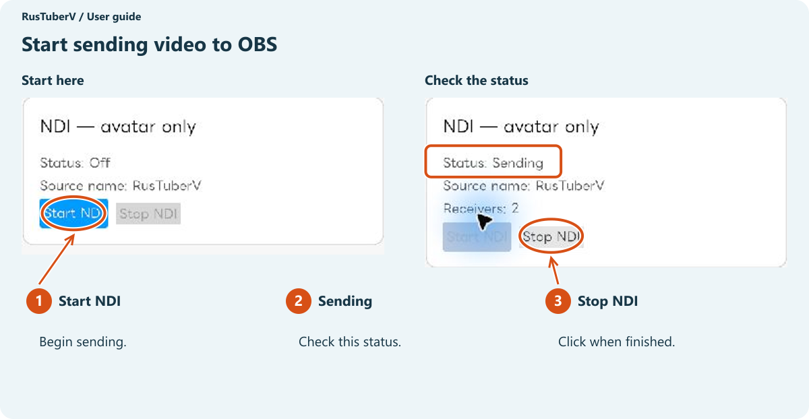

NDI sends the avatar video. Settings panels and the camera image shown for checking your position are not included.

### 2. Receive it in OBS

Click **+** in the OBS **Sources** panel.

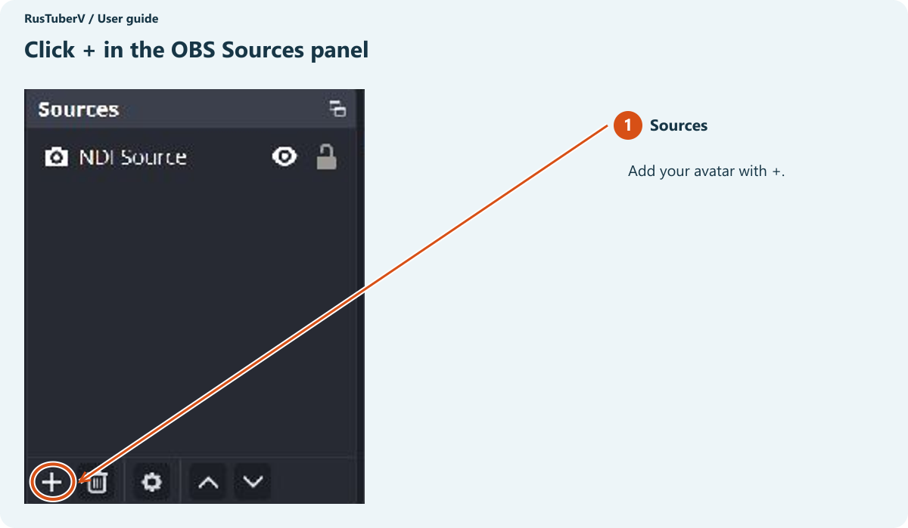

Choose **NDI Source → Add a new NDI Source**. If prompted for a name, enter one you will recognize and continue.

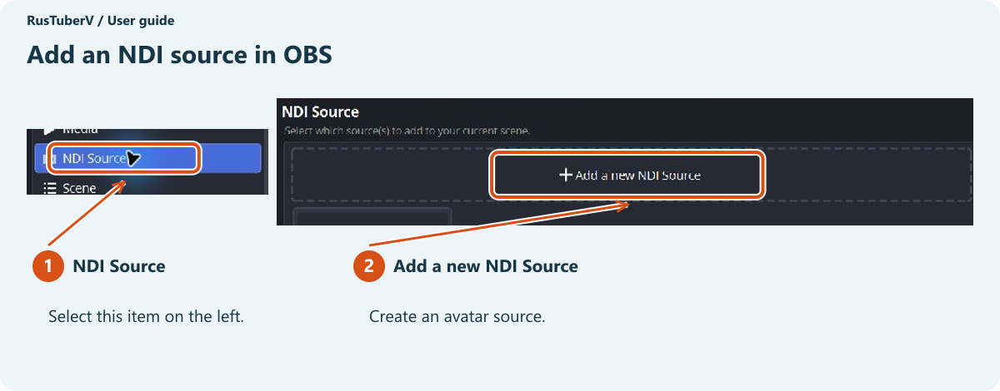

In **Source name**, select the entry ending with **(RusTuberV)**. The computer name at the beginning varies.

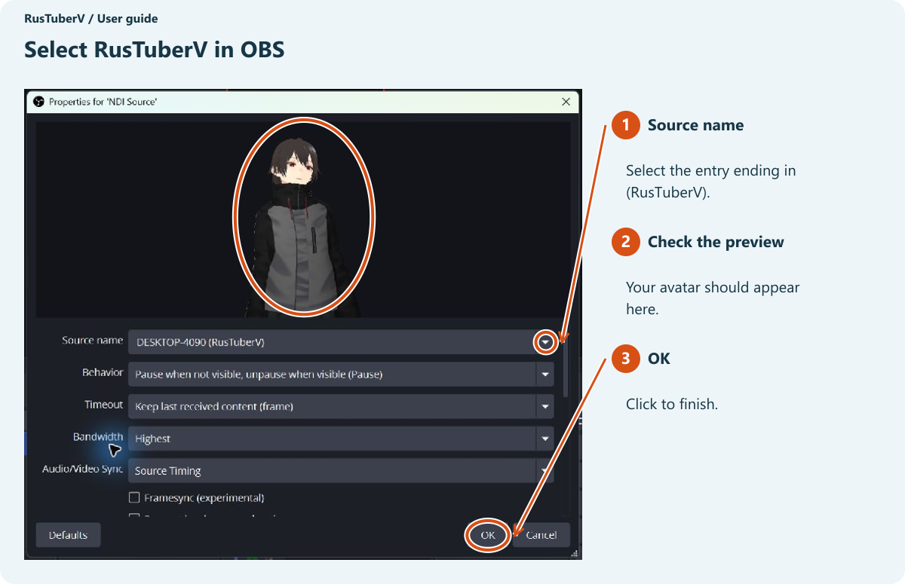

When the avatar appears in the preview, click **OK**. Select the source in OBS and drag the corners of the red frame to resize it. Drag inside the frame to move it.

The avatar background is transparent. To add a background image or game capture, place **the avatar above the background** in the OBS Sources list. Set up your microphone in OBS for your voice.

### Before going live

- Check that the avatar is visible and responds to your face and hands.
- Check that the OBS microphone meter moves when you talk.
- Make a short recording in OBS and play it back to check the picture and sound.

Once your streaming destination is configured, click **Start Streaming** in OBS.

### When you finish

**Stop streaming or recording in OBS → Click Stop NDI in RusTuberV → Close the app.**

**Stop NDI** stops passing video to OBS. Stop the stream or recording in OBS itself.

## Troubleshooting

### If the app does not start

Extract the entire ZIP and keep all bundled files together. On Windows, a startup error dialog shows the cause and the affected configuration file or managed folder path.

For a `settings.toml` or `tracking_profile.toml` error, back up the indicated file before inspecting it. Malformed TOML and unsupported schemas are not automatically reset. If a newer app version saved the settings, use a compatible version. For access errors, check read/write permissions at the displayed path. Include the app version and the complete error text when reporting a problem.

If no dialog appears, or for the first launch on Mac, check the requirements and startup instructions in the [release notes](https://github.com/matsuvr/RusTuberV/releases/latest).

### Problems after startup

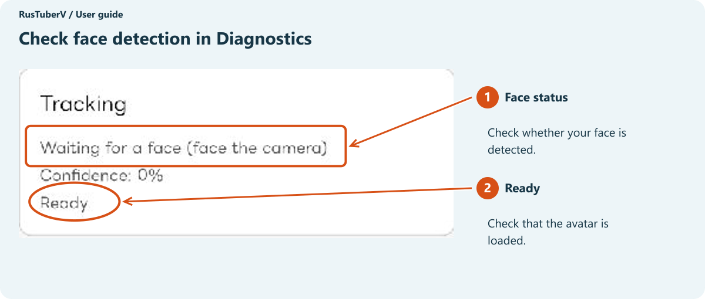

| Problem | What to try |
| --- | --- |
| Camera missing from the list | Check the connection and click Refresh cameras. Close other apps using the camera. Check OS camera permission |
| Avatar does not move | Select a VRM and camera. Check the face status in Diagnostics and face the camera. Add lighting in front of your face if needed |
| Face not detected | Adjust your distance from the camera so your face fits in the frame |
| Avatar tilts while you face forward | Use Pose & camera → Neutral pose → Redo |
| Hands do not move correctly | Check Track arms from the webcam. Keep shoulders, elbows, wrists, and hands visible. Use Recalibrate arm length if needed |
| Avatar too small or cut off | Adjust with the wheel or right-drag. Use Reset avatar framing to start again |
| Expression keys do not respond | Select the RusTuberV window. Close open lists or file dialogs before pressing the key |
| OBS has no NDI Source | Install DistroAV and the required NDI Runtime, then restart OBS |
| RusTuberV missing from the OBS list | Check that RusTuberV says Sending. Reopen the Source name list in OBS |
| Receivers reads 0 | Select RusTuberV in OBS and make the source visible. Receivers counts connections receiving the video |
| NDI runtime not found | Keep the complete app folder together. For NDI, install the runtime specified by the app distributor |
| Model loading failed | Check that the file is a `.vrm`, then try Retry load. Try another avatar too |

### Check your camera image

Scroll down in **Pose & camera** and click **Preview camera…**. Read the message and click **Show camera image** to check your position. When finished, click **Hide camera** or press Esc.

**If OBS captures the app window or your desktop, this camera image will be captured too.** Check the OBS preview before streaming or recording. [OBS Window Capture captures the selected window.](https://obsproject.com/kb/window-capture-sources)

## Show the avatar on Looking Glass

If you have a Looking Glass display, you can show your avatar on it too.

1. Connect the display and start Looking Glass Bridge.
2. Open **Looking Glass output** on the left.
3. Select your device and click **Start output**.
4. Click **Stop output** when finished.

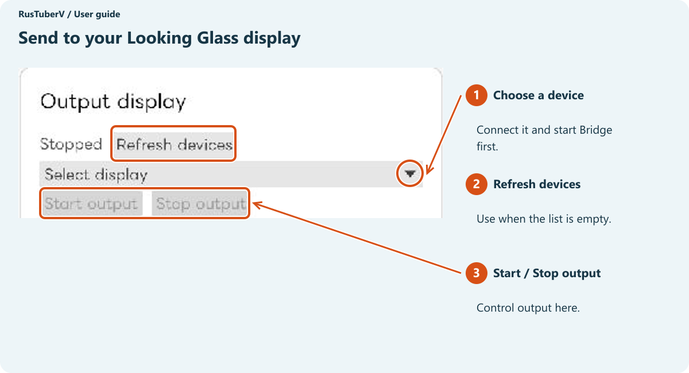

If no Looking Glass device is found, check the connection and that Bridge is running, then click **Refresh devices**.

---

Screen examples: RusTuberV 0.1.0 for Windows and OBS Studio 32.2.2. Avatar: AvatarSample_C by pixiv VRoid Project. The avatar file is not included in this guide.

[Project README](../../README.en.md)
