# RusTuberV 利用マニュアル

**日本語** · [English](../en/README.md) · [简体中文](../zh-CN/README.md) · [한국어](../ko/README.md)

Webカメラに向かって、話したり、笑ったり、手を動かしたり。アバターを動かして、OBSに映してみましょう。

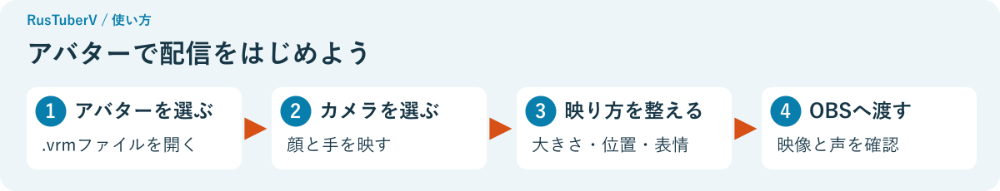

**[はじめる](#はじめる)** · **[映り方を整える](#映り方を整える)** · **[表情を変える](#表情を変える)** · **[OBSに映す](#obsに映す)** · **[困ったとき](#困ったとき)**

## はじめる

### 用意するもの

| 用意するもの | 使い道 |
| --- | --- |
| RusTuberVのアプリ一式 | アバターを表示する |
| アバターの `.vrm` ファイル | 自分の姿として使う。VRM 0.x・1.0に対応 |
| Webカメラ | 顔や手の動きを映す。パソコン内蔵のカメラでも使えます |

配信や録画をする場合は、[OBS Studio](https://obsproject.com/)も用意します。まずはRusTuberVだけで動きを試せます。

### アプリを開く

Windowsでは、アプリのフォルダーにある **RusTuberV.exe** をダブルクリックします。ZIPで受け取った場合は、右クリックして **「すべて展開」** してから開きます。

**フォルダーの中身はまとめて置いておきます。** RusTuberV.exeだけを別の場所に移さずに使ってください。

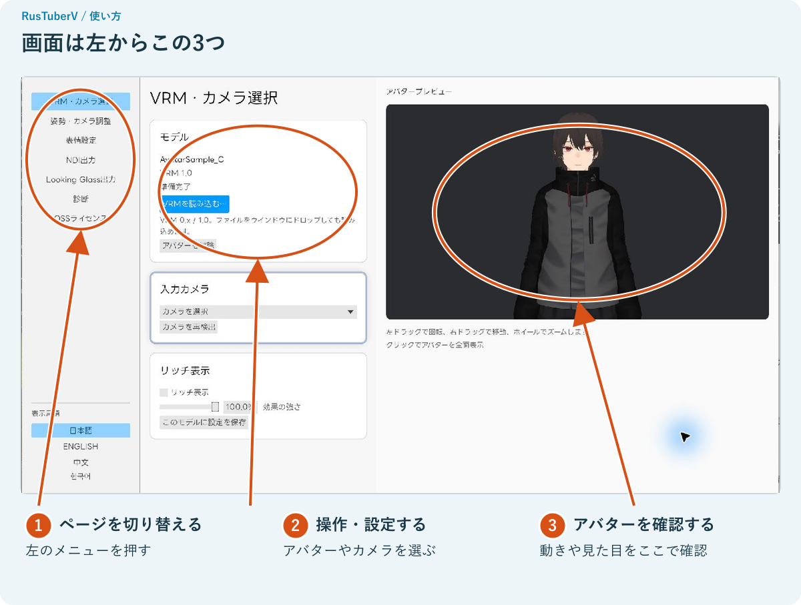

### 1. アバターを選ぶ

**「VRMを読み込む…」** を押して、使いたい `.vrm` ファイルを選びます。

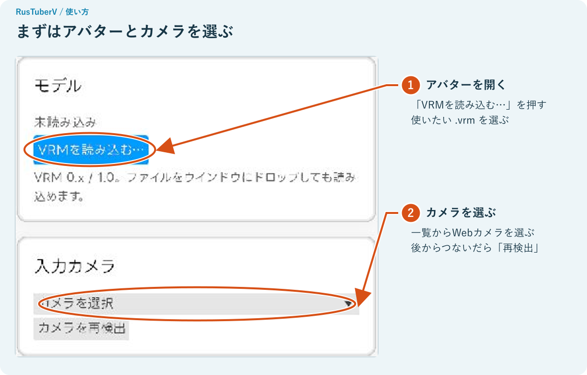

ファイルをアプリのウインドウへドラッグしても選べます。

利用条件の画面が出たら、中の欄を下へスクロールして内容を確認します。条件に合う使い方であることを確認できたら、下のチェックを入れて **「読み込む」** を押します。

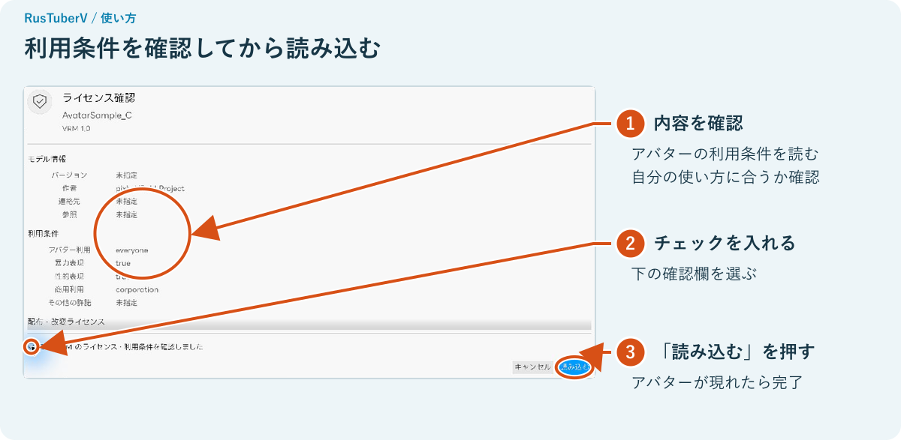

右側にアバターが現れ、**「準備完了」** と表示されたら読み込み完了です。

### 2. カメラを選ぶ

左の **「VRM・カメラ選択」** で、**「入力カメラ」** の一覧から使うカメラを選びます。表示される名前はパソコンによって変わります。

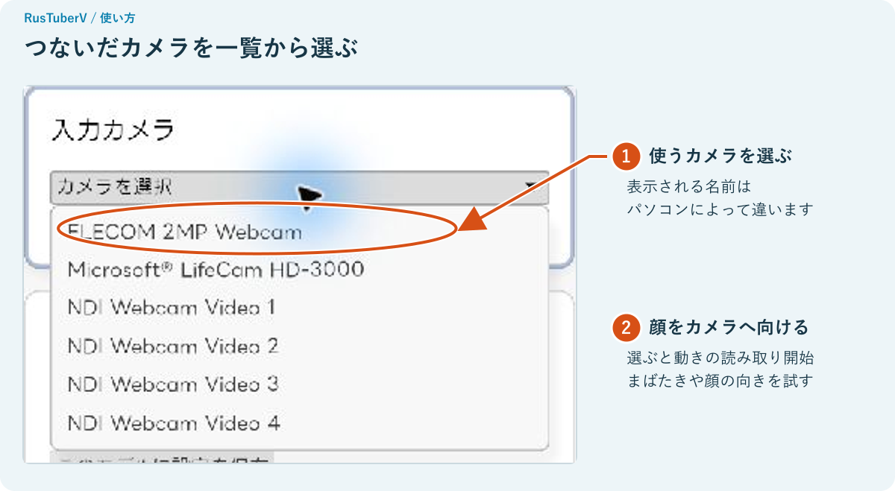

カメラに顔を向けて、まばたきや顔の向きを変えてみましょう。カメラの映像を画面に表示しなくても、アバターは動きます。

**見つからないときは「カメラを再検出」。** カメラを後からつないだときも使えます。

## 映り方を整える

### 顔を正面に合わせる

左の **「姿勢・カメラ調整」** を開き、カメラの正面で自然な表情にします。最初に顔を見つけると、その向きが自動で基準になります。

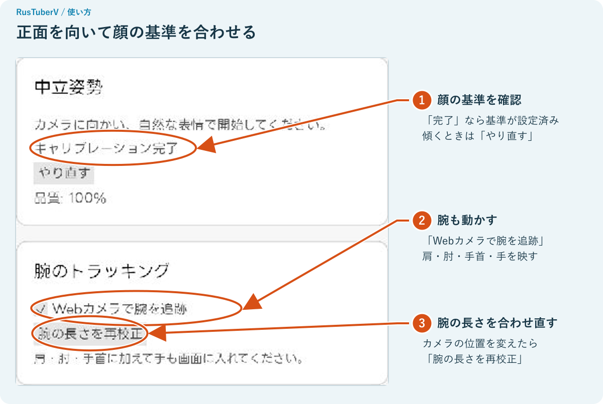

正面を向いているのにアバターが傾くときは、**「中立姿勢」→「やり直す」**。顔の検出を待っている間は、カメラに顔を向けます。

**手も動かすなら、肩・肘・手首・手が映る位置へ。** 「Webカメラで腕を追跡」のチェックを入れます。カメラの位置を変えて腕の動きが合わなくなったときは、「腕の長さを再校正」を押します。

### 大きさ・位置・向きを変える

右側のアバター画像の上で操作します。

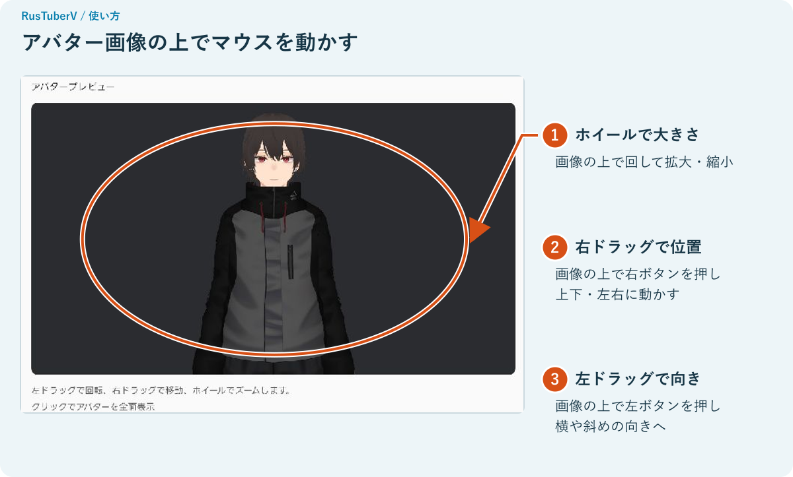

| やりたいこと | 操作 |
| --- | --- |
| 大きく・小さくする | マウスのホイールを回す |
| 上下・左右へずらす | 右ボタンを押しながらドラッグ |
| 横や斜めから見る | 左ボタンを押しながらドラッグ |
| 最初の画角に戻す | 「姿勢・カメラ調整」を下へスクロール →「アバターの画角をリセット」 |

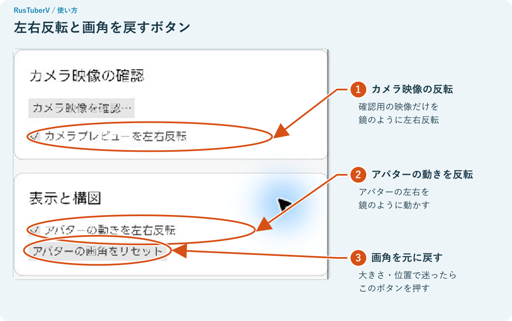

「アバターの動きを左右反転」を使うと、鏡を見ているように動きます。「カメラプレビューを左右反転」は、確認用のカメラ映像だけを反転します。

### アバターを大きく表示する

右側のアバター画像を **一度クリック** すると、設定欄が閉じてアバターが全面に表示されます。右上の青いボタンを押すと、設定欄に戻ります。

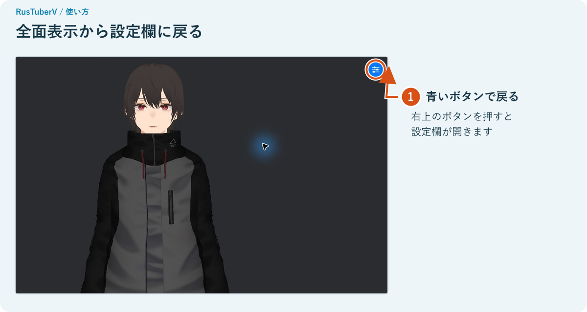

### 見た目に変化を付ける

**「VRM・カメラ選択」→「リッチ表示」** にチェックを入れると、光や輪郭などの見え方が変わります。「効果の強さ」で好みに合わせ、**「このモデルに設定を保存」** を押すと、同じアバターを読み込んだときにも使えます。

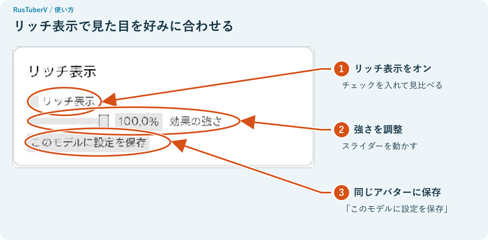

腕の置き方を調整したいときは、「姿勢・カメラ調整」の「腕の姿勢」を使います。「腕下げ」は腕を下げる量、「指の曲げ」は指を曲げる量です。少しずつ動かして右側の姿を確認します。

## 表情を変える

左の **「表情設定」** を開きます。キーの横に、そのキーで出せる表情が表示されます。

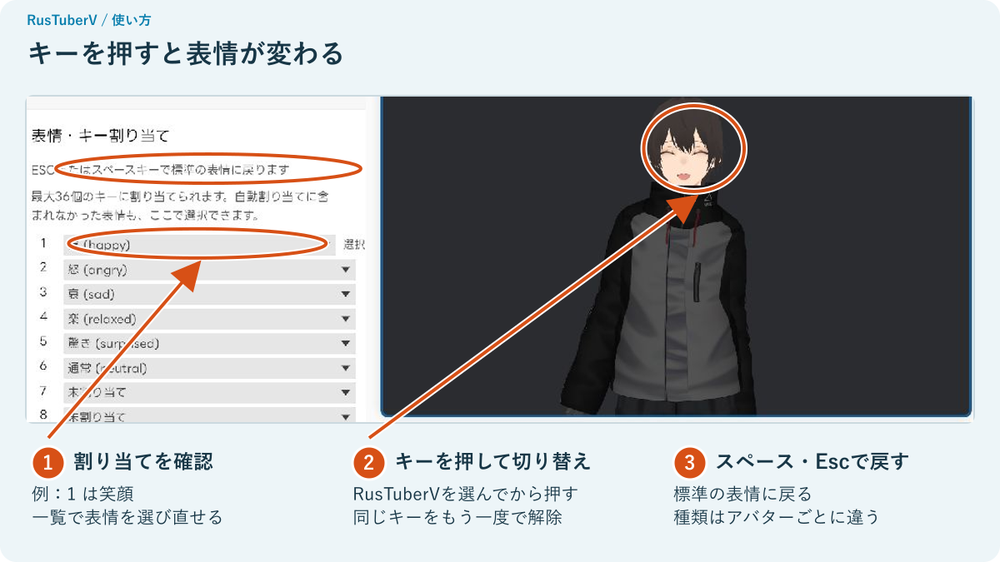

**RusTuberVのウインドウを選んでから** キーを押します。

数字キーは、キーボードの上段にあるものを使います。

| 操作 | 結果 |
| --- | --- |
| 割り当てられたキーを押す | その表情になる |
| 同じキーをもう一度押す | その表情を解除する |
| スペース、またはEscを押す | 標準の表情に戻る |

キーの横の一覧を開くと、表情を選び直せます。表情の種類はアバターごとに違います。画面の例では「1」が笑顔です。

割り当てはアバターごとに保存されます。下までスクロールすると、**「表情を解除」** と **「初期割り当てに戻す」** があります。

## OBSに映す

### 最初に一度だけ準備する

OBSでアバターを受け取るために、**DistroAV** を入れます。OBSに「NDI Source」がすでにある場合は、そのまま次へ進めます。

1. OBSを閉じます。
2. [DistroAVの公式配布ページ](https://distroav.org/download)から、お使いのOSに合うものをインストールします。
3. [公式の導入手順](https://github.com/DistroAV/DistroAV/wiki/1.-Installation)に従って、必要なNDI Runtimeも入れます。
4. OBSを開き直します。

NDIは、アバターの映像をOBSに渡すための機能です。**[DistroAVはOBSでNDI映像を受け取る機能を追加します。](https://github.com/DistroAV/DistroAV#distroav-features)**

### 1. RusTuberVから映像を送る

左の **「NDI出力」→「NDI送信を開始」** を押します。**「状態：送信中」** になったら次へ。

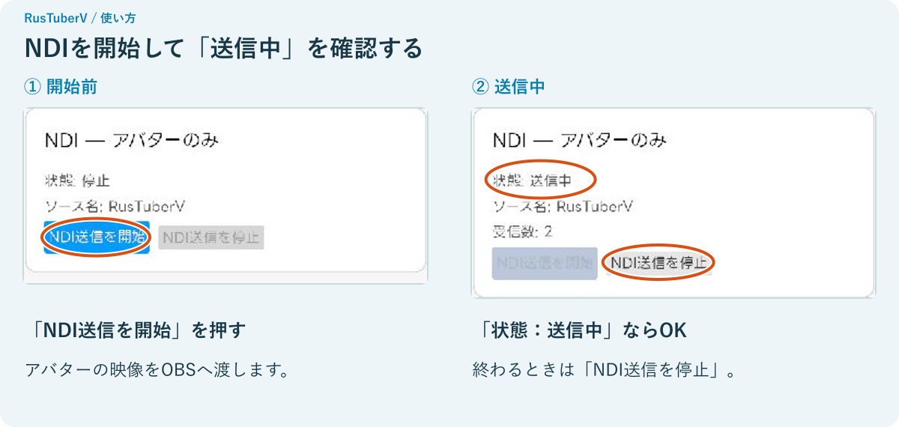

NDIで渡すのはアバターの映像です。設定欄や、確認用に表示したカメラ映像は含まれません。

### 2. OBSで受け取る

OBSの **「ソース」** にある **「＋」** を押します。

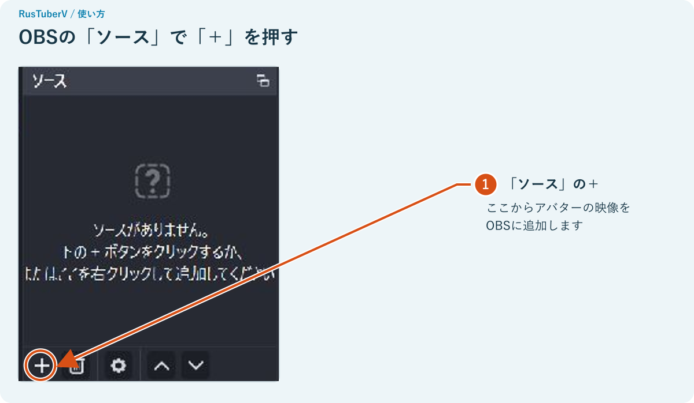

**「NDI Source」→「新しいソースを作成」** を選びます。作成名の確認が出た場合は、分かりやすい名前を付けて進めます。

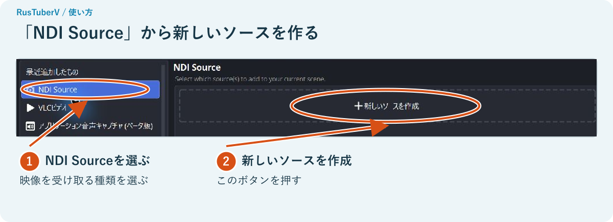

**「Source name」** の一覧で、末尾に **「(RusTuberV)」** と付いたものを選びます。先頭のパソコン名は環境によって変わります。

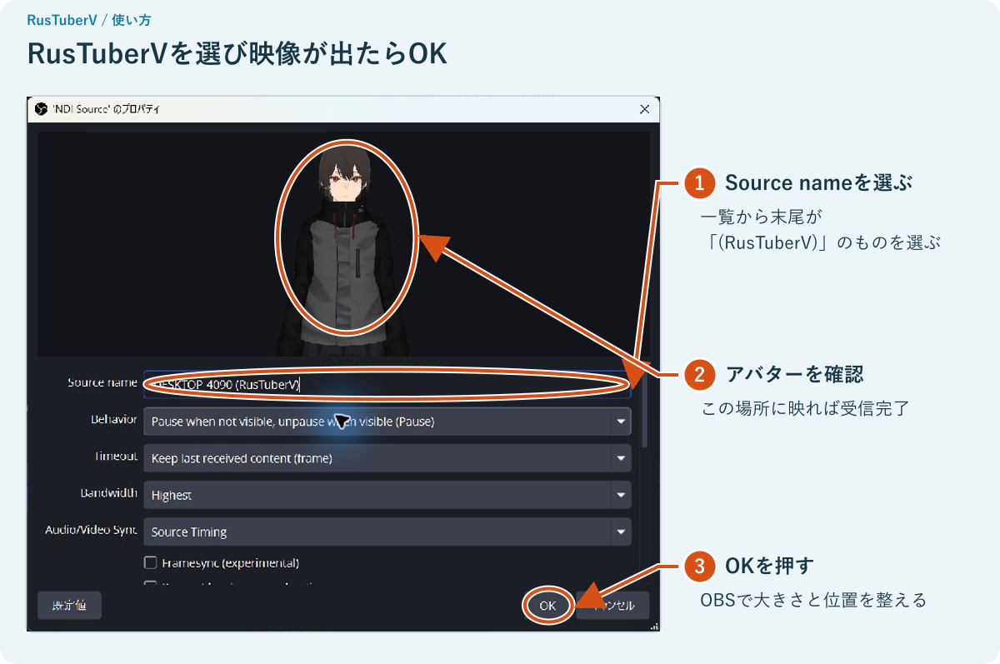

上の確認画面にアバターが出たら **「OK」**。OBSの画面でソースを選び、赤い枠の角をドラッグして大きさを整えます。枠の内側をドラッグすると位置を変えられます。

アバターの背景は透けます。背景画像やゲーム画面を重ねる場合は、OBSの「ソース」一覧で **アバターを上、背景を下** に並べます。声はOBS側でマイクを設定します。

### 配信前に確認する

- アバターが映って、顔や手の動きが反映されている。
- OBSのマイクのメーターが、話すと動く。
- OBSで短く録画して、映像と声を再生して確認する。

配信先の設定が済んだら、OBSで **「配信開始」** を押します。

### 終わるとき

**OBSで配信・録画を停止 → RusTuberVの「NDI送信を停止」→ アプリを閉じる。**

「NDI送信を停止」は、OBSへ映像を渡す機能を止めるボタンです。配信・録画はOBS側で止めます。

## 困ったとき

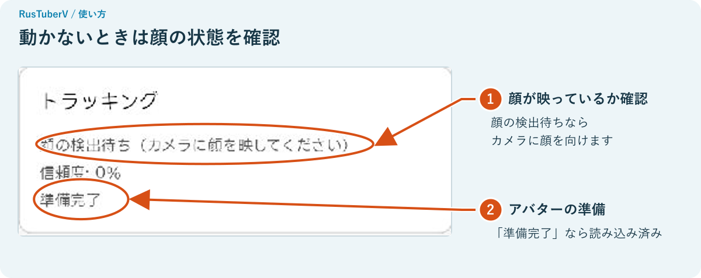

| こんなとき | 試すこと |
| --- | --- |
| カメラが一覧にない | 接続を確認して「カメラを再検出」。他のアプリがカメラを使っていたら閉じる。OSのカメラ利用許可も確認する |
| アバターが動かない | VRMとカメラを選ぶ。「診断」で顔の状態を確認し、カメラに顔を向ける。顔が暗いときは照明を顔の前へ |
| 顔が見つからない | カメラとの距離を調整し、顔が画面に収まるようにする |
| 正面を向いても傾く | 「姿勢・カメラ調整」→「中立姿勢」→「やり直す」 |
| 手がうまく動かない | 「Webカメラで腕を追跡」を確認。肩・肘・手首・手を画面に入れる。必要なら「腕の長さを再校正」 |
| アバターが小さい・見切れる | ホイールや右ドラッグで調整。戻すなら「アバターの画角をリセット」 |
| 表情キーが反応しない | RusTuberVのウインドウを選ぶ。開いている一覧やファイル選択画面を閉じてから押す |
| OBSに「NDI Source」がない | DistroAVと必要なNDI Runtimeを入れ、OBSを開き直す |
| OBSの一覧にRusTuberVがない | RusTuberVが「送信中」か確認。OBSでSource nameの一覧を開き直す |
| 「受信数：0」と表示される | OBSでRusTuberVを選び、ソースを表示する。受信数は、映像を受け取っている接続の数 |
| NDIランタイムが見つからない | アプリ一式を同じフォルダーに置く。NDIを使う場合は、配布元が案内するランタイムを用意する |
| 読み込みに失敗した | `.vrm` ファイルか確認し、「再読み込み」を試す。別のアバターでも確認する |

### 自分のカメラ映像を確認したい

「姿勢・カメラ調整」を下へスクロールし、**「カメラ映像を確認…」** を押します。内容を確認して「確認して映像を表示」を押すと、顔の位置を見られます。終わったら **「カメラ映像を隠す」**、またはEscで隠します。

**OBSでウインドウやデスクトップを取り込んでいると、この確認映像も映ります。** 配信・録画の前にOBSの画面を確認してください。[OBSのウインドウキャプチャは、選んだウインドウを取り込みます。](https://obsproject.com/kb/window-capture-sources)

## Looking Glassに映す

Looking Glassを持っている場合は、アバターをその画面にも表示できます。

1. Looking Glassをつなぎ、Looking Glass Bridgeを起動します。
2. 左の **「Looking Glass出力」** を開きます。
3. 一覧から機器を選んで **「出力開始」** を押します。
4. 終わったら **「出力停止」** を押します。

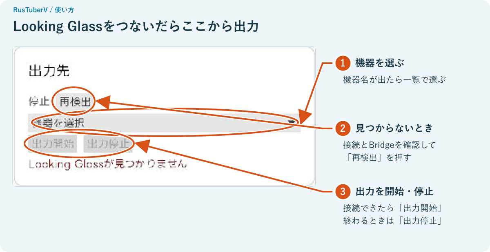

「Looking Glassが見つかりません」と出たら、接続とBridgeの起動を確認し、**「再検出」** を押します。

---

画面例：Windows版RusTuberV 0.1.0、OBS Studio 32.2.2。アバター：AvatarSample_C（pixiv VRoid Project）。アバター本体はこのマニュアルに含まれません。
