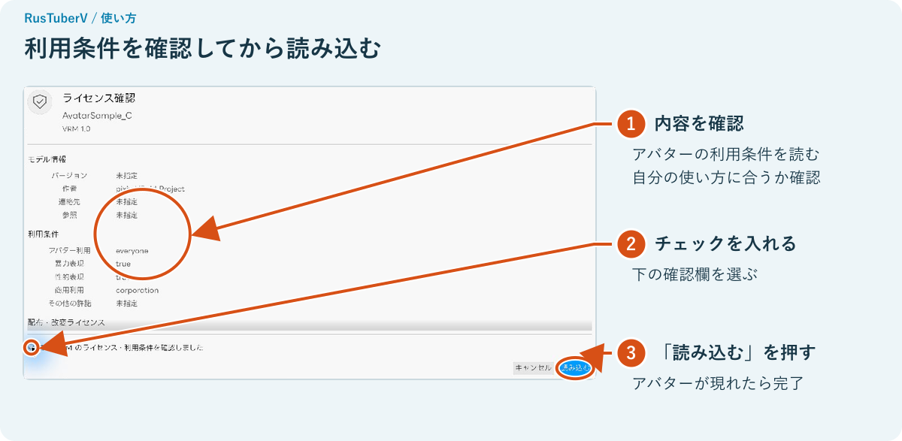
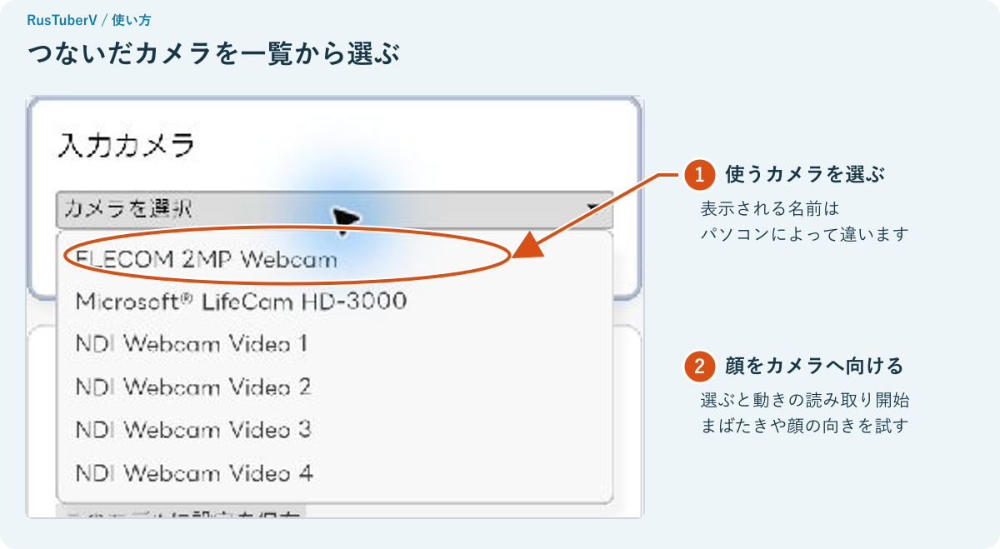
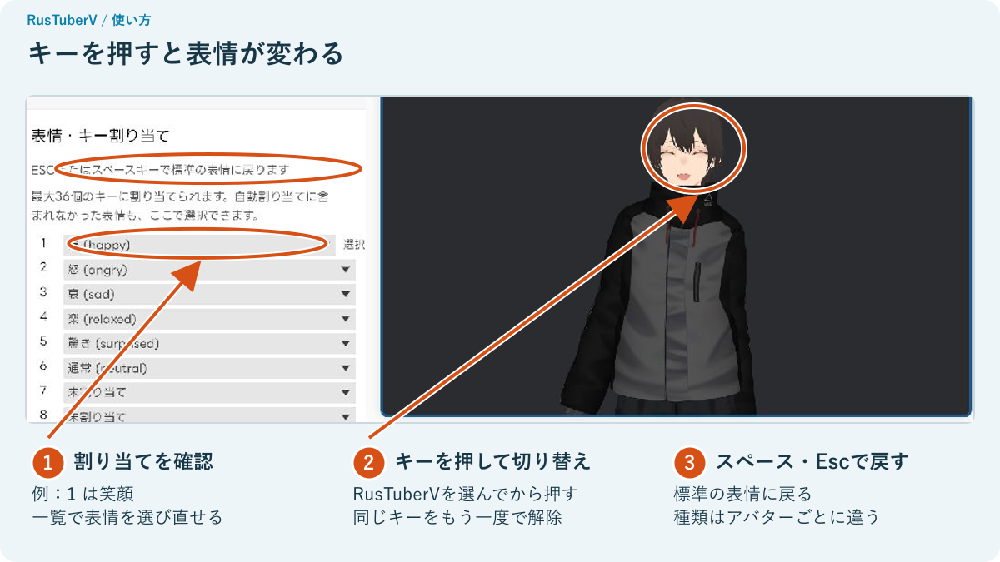
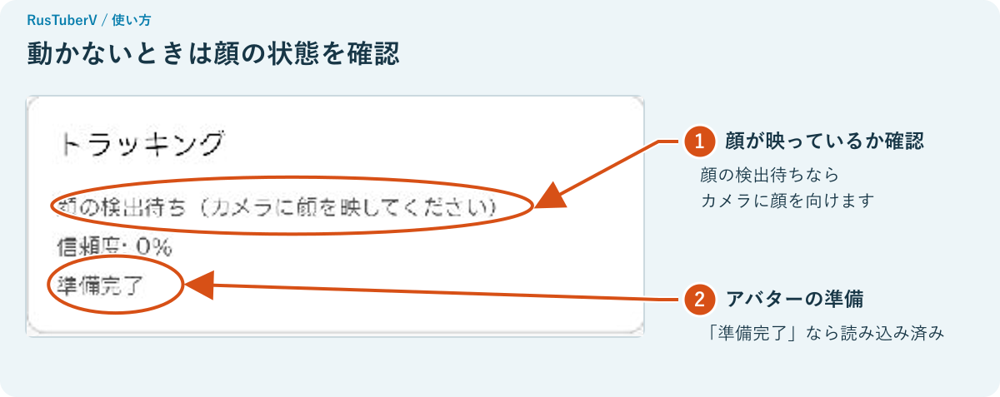
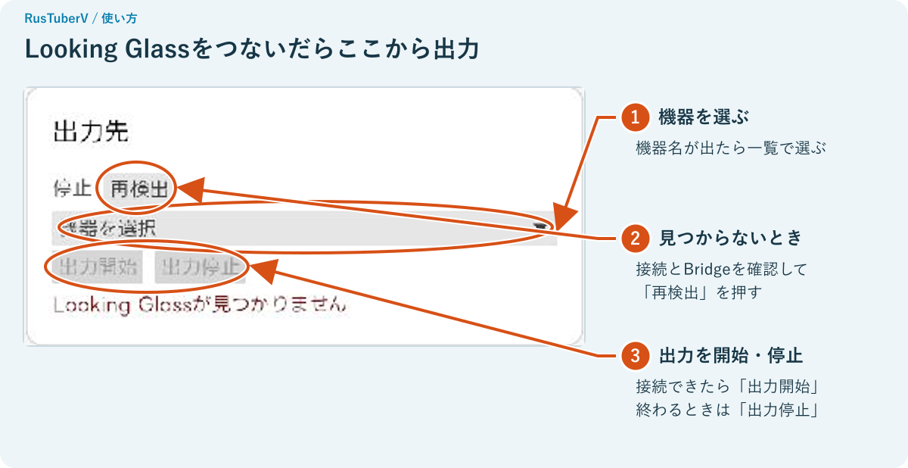

# RusTuberV 利用マニュアル

本マニュアルでは、導入から配信ソフトとの連携、不具合発生時の対処法までを順に解説します。設定作業は以下の流れで進めてください。

| 手順 | 操作 | 確認・調整する内容 |
| --- | --- | --- |
| 1 | アバターの読み込み | 使用する`.vrm`ファイルの選択 |
| 2 | 入力カメラの選択 | 顔や手が収まる撮影位置の確認 |
| 3 | 表情と画角の調整 | 大きさや向き、表情の割り当て設定 |
| 4 | OBSとの接続 | 配信用映像と音声の動作確認 |

## 起動と初期設定

### 必要な機材とファイル

| 用意するもの | 使い道 |
| --- | --- |
| RusTuberVのアプリ一式 | 本体プログラムを実行する |
| アバターの`.vrm`ファイル | 自身の姿として使う（VRM 0.xと1.0に対応） |
| Webカメラ | 顔や手の動きを取得する（パソコン内蔵品でも利用可能） |

配信や録画を行う場合は[OBS Studio](https://obsproject.com/)も用意してください。なお、OBSの準備前に単体で動作を試せます。

### アプリの起動

Windows環境では、フォルダー内の`RusTuberV.exe`をダブルクリックして実行します。配布ファイルがZIP形式の場合は、右クリックメニューの「すべて展開」で中身を取り出してから開いてください。なお、フォルダー内のファイル群は必ず同じ階層へまとめた状態で起動する必要があります。

Mac環境では展開後のZIPから`RusTuberV.app`をアプリケーションフォルダーへ移して開きます。初回起動時の許可操作は、macOSの「システム設定」内「プライバシーとセキュリティ」にある「このまま開く」で行います。

<small>（画面構成図：左側のメニュー選択、中央の詳細設定、右側のプレビュー確認を行う基本レイアウトです）</small>

### 1. アバターの読み込み

「VRMを読み込む…」ボタンから使用する`.vrm`ファイルを選びます。アプリのウインドウ上へ直接ファイルをドラッグしても選択可能です。

<small>（操作箇所の案内：図中の丸1が読み込みボタン、丸2が後述するカメラ選択欄です）</small>

利用条件の確認画面が表示されたら、枠内を下方へスクロールして規約全文に目を通してください。条件に合致する用途であることを確認したうえで下部のチェックボックスへ印を入れ、「読み込む」ボタンを押します。

<small>（利用条件の同意画面の例です）</small>

画面右側へモデルが現れて「準備完了」と表示された段階で読み込み作業は終わりです。

### 2. 入力カメラの選択

左側の「VRM・カメラ選択」メニューにある「入力カメラ」の一覧から使用機器を選びます。表示される機器名はご利用のパソコン環境によって異なります。

<small>（カメラ選択欄の画面例です）</small>

レンズの正面へ顔を向けてまばたきや首の傾きを変え、それらの動きが画面上のモデルへ連動するか確かめてください。カメラを後から接続した場合は、「カメラを再検出」ボタンを押すと一覧へ反映されます。

## 姿勢と画角の調整

### 中立姿勢の校正

左側の「姿勢・カメラ調整」ページを開いたら、カメラの正面で自然な表情を作ります。アプリが最初に顔を認識した時点の向きが自動で基準値として登録されます。

<small>（校正完了時の表示例と、腕追跡用の設定項目です）</small>

正面を向いている状態でモデルが傾いてしまう場合は、「中立姿勢」欄の「やり直す」を押したうえで顔が再認識されるまでカメラを見つめてください。

腕と手も連動させるときは、肩から肘、手首、指先までが収まる位置へカメラを置いたうえで「Webカメラで腕を追跡」のチェック欄を有効にします。カメラの設置場所を変更した後は、「腕の長さを再校正」を押して基準を取り直してください。

### アバターの表示サイズ・位置・向き

右側のアバター表示領域に対するマウス操作と設定欄の項目を使って構図を整えます。

<small>（プレビュー上での操作イメージです）</small>

| やりたいこと | 操作 |
| --- | --- |
| 拡大と縮小 | マウスのホイールを回す |
| 上下・左右への移動 | 右ボタンを押しながらドラッグする |
| 角度や向きの変更 | 左ボタンを押しながらドラッグする |
| 初期画角への復帰 | 「姿勢・カメラ調整」の下部にある「アバターの画角をリセット」を押す |

<small>（表示と構図の設定項目一覧です）</small>

「アバターの動きを左右反転」を有効にすると鏡を見るように動きます。一方、「カメラプレビューを左右反転」の切り替え対象は確認用のカメラ映像です。

### アバターの全面表示

右側のアバター画像を一度クリックすると、設定欄が閉じてモデルが画面全体へ大きく表示されます。設定欄を再び開く際は、右上の青いボタンを押してください。

<small>（全面表示モードにおける設定復帰ボタンの位置です）</small>

### 腕と指の姿勢

腕の待機姿勢を微調整したい場合は、「姿勢・カメラ調整」内にある「腕の姿勢」項目を使用します。腕を落とす度合いは「腕下げ」、指を曲げる度合いは「指の曲げ」の各数値で少しずつ変えながら、右側の表示結果を確認してください。

## 表情の切り替え

左側の「表情設定」ページを開くと、各キーの横に割り当てられた表情名が表示されます。キー操作を行う際は、あらかじめRusTuberVのウインドウを選択した状態でキーボード上段の数字キーなどを押してください。

<small>（「1」のキーへ笑顔を割り当てた設定画面の例です）</small>

| 操作 | 結果 |
| --- | --- |
| 割り当て済みのキーを押す | 対応する表情へ切り替わる |
| 同じキーを再度押す | その表情が解除される |
| スペースキーまたはEscキーを押す | 標準の表情へ戻る |

割り当て内容を変更する際は、キー横の一覧から選び直してください。選択できる表情の種類はアバターごとに固有です。設定情報はモデル単位で記録されます。一括で状態をリセットしたい場合は、ページ最下部にある「表情を解除」や「初期割り当てに戻す」を押してください。

### アバターの見た目と表情

髪や肌の色、質感の描画にはVRMデータ内のマテリアルが用いられます。まばたきや口の動き、キー操作による表情変化は、モデルに収録された表情データに基づいて再現されます。

## OBSへの映像送信

左側の「NDI・Spout2出力」ページから背景を透過したアバター映像を送出します。プレビュー画面で調整した大きさや位置、向きは送信映像にもそのまま反映されます。NDIとSpout2は個別の開始や停止操作、さらに両方式の同時稼働にも対応しています。

| 使う場面 | 方式 | OBSに用意するもの |
| --- | --- | --- |
| 同じWindows PC内のOBSへ送る | Spout2 | `OBS Spout2 plugin` |
| WindowsやMacで同一端末または同一ネットワーク上のOBSへ送る | NDI | DistroAVと対応するNDI Runtime |

### Spout2の送信設定（Windows）

1. OBSを完全に終了したうえで、[公式配布ページ](https://github.com/Off-World-Live/obs-spout2-plugin/releases)からOBSのバージョンに適合する`OBS Spout2 plugin`を導入してOBSを再起動します。
2. RusTuberVでアバターを読み込んでから、左側の「NDI・Spout2出力」を開きます。
3. 「Spout2送信を開始」を押して「RusTuberV: 送信中」の表示へ変わったか確かめます。
4. OBSの「ソース」欄にある「＋」から「Spout2 Capture」を追加したうえで、送信元として`RusTuberV`を指定します。
5. Spout2 Captureの設定画面で「Composite Mode」を「Premultiplied Alpha」へ変更します。
6. OBSのソース一覧上で、アバターのソースを背景画像やゲーム画面より上位の順番へ配置します。

OBSとRusTuberVは同一のGPUで実行してください。出力解像度は1920×1080です。送信の再開方法や使用するGPUの指定については、[Spout2側の案内手順](../SPOUT2.md)を参照してください。

### NDIの送信設定（Windows・Mac）

あらかじめお使いのOSとOBSのバージョンに適合する[DistroAV](https://distroav.org/download)およびNDI Runtimeを[公式手順](https://github.com/DistroAV/DistroAV/wiki/1.-Installation)に従って導入してから、OBSを再起動してください。OBSのソース追加メニューに「NDI Source」が既にある場合は、そのまま以下の送信操作へ進めます。

#### 1. RusTuberVでの送信操作

左側の「NDI・Spout2出力」を開いて「NDI送信を開始」を押したあと、「状態：送信中」と表示されたらOBS側で受信設定を行います。NDI®からは背景透過済みの映像が送られるため、マイク音声はOBS側で個別に設定して取り込んでください。

#### 2. OBSでの受信設定

OBSの「ソース」欄下部にある「＋」ボタンから「NDI Source」の「新しいソースを作成」を選びます。名前の入力画面が出た際は、判別しやすい名称を付けて確定してください。

<small>（OBSのソース追加ボタンおよび「NDI Source」の新規作成画面の例です）</small>

「Source name」の一覧から末尾に「(RusTuberV)」が付いた項目を選択します。先頭に付くパソコン名はご利用環境によって変化します。確認画面へアバターが映ったら「OK」を押してください。

<small>（Source nameの選択および確認画面の例です）</small>

OBSのプレビュー上でソースを選択したうえで、赤い枠の角をドラッグすると大きさ、枠の内側をドラッグすると表示位置を変えられます。背景画像やゲーム画面と合成する場合は、前述したSpout2の手順と同じくアバターのソースを上位へ並べてください。

### 配信前の映像と音声の確認

1. アバターの表示とともに顔や手の動きが反映されているか確かめます。
2. OBS側でマイクを設定したうえで、発声に合わせて音量メーターが振れるか見ます。
3. 短時間のテスト録画を実施して映像と音声の記録状態を再生確認します。
4. 配信先の設定を終えたら、OBSで「配信開始」を押します。

### 配信・録画の終了手順

1. OBSの配信や録画を停止します。
2. RusTuberVの「NDI・Spout2出力」にある「Spout2送信を停止」または「NDI送信を停止」から稼働中の出力を止めます。
3. RusTuberV本体を終了します。

NDI® is a registered trademark of Vizrt NDI AB.

## 問題が起きたときの確認事項

### 起動時のエラー

起動に失敗した場合は、ZIPの展開状態と必要な同梱ファイルの配置先をあらためて見直してください。Windows版で起動エラーが生じた際は、ダイアログ上に原因や設定ファイル、管理用フォルダーのパスが表示されます。

`settings.toml`や`tracking_profile.toml`に関するエラーが出た場合は、該当ファイルのバックアップを作成したうえでTOML書式と設定バージョンを確かめてください。新しいバージョンで保存した設定ファイルを扱う際は、それに対応したバージョンのアプリを用います。アクセス権のエラー時は、表示されたパスの読み書き権限を確認してください。お問い合わせの際には、アプリのバージョンとエラーメッセージの全文を添えてご連絡ください。なお、動作環境やMac版の初回起動手順は[リリース説明](https://github.com/matsuvr/RusTuberV/releases/latest)にも記載しています。

### 起動後の確認項目

<small>（診断画面のトラッキング欄における顔認識状態の表示例です）</small>

| 確認する項目 | 操作 |
| --- | --- |
| カメラの選択 | 接続状態を見直したうえで「カメラを再検出」を押す。他のアプリがカメラを使用している場合は閉じる。OS側のカメラ利用許可も確認する |
| アバターの動き | VRMとカメラの指定後、「診断」画面で認識状態を見ながらカメラの方へ顔を向ける。周囲が暗い場合は顔の前に照明を補う |
| 顔の検出 | カメラとの距離を調整し、顔全体が画角内に収まるようにする |
| 正面の向き | 「姿勢・カメラ調整」の「中立姿勢」にある「やり直す」を押す |
| 腕・手の追跡 | 「Webカメラで腕を追跡」の有効状態を確認したうえで、肩から手までを画角内へ入れる。必要に応じて「腕の長さを再校正」も実行する |
| アバターの表示範囲 | マウスホイールや右ドラッグで構図を整える。初期状態へ戻す際は「アバターの画角をリセット」を押す |
| 表情キーの操作 | RusTuberVのウインドウをアクティブにしたうえで、開いている一覧やファイル選択ダイアログを閉じてからキーを押す |
| Spout2の受信 | `OBS Spout2 plugin`とOBSの対応バージョンを確認したうえで、両アプリを同一GPUで実行して送信元に`RusTuberV`を指定する |
| Spout2の背景透過 | Spout2 Captureの「Composite Mode」を「Premultiplied Alpha」へ変更する |
| NDIソースの追加 | DistroAVと対応するNDI Runtimeを導入してからOBSを再起動する |
| NDIの送信元 | RusTuberV側が「送信中」であるか確認してから、OBS側でSource nameの一覧を開き直す |
| NDIの受信数 | OBS上でRusTuberVを選択してソースを表示する。受信数は映像を受け取っている接続数を示す |
| NDIランタイム | アプリ一式を同一フォルダー内へ配置する。NDI利用時は配布元の案内通りにランタイムを準備する |
| VRMの読み込み | ファイル拡張子が`.vrm`であるか確かめたうえで「再読み込み」を試す。別のアバターファイルでの読み込みも検証する |

### カメラ映像のプレビュー

「姿勢・カメラ調整」を下へスクロールして「カメラ映像を確認…」を押し、注意事項を読んだうえで「確認して映像を表示」を押すと実際のカメラ映像で顔の位置を確かめられます。確認後は「カメラ映像を隠す」ボタンまたはEscキーで映像を閉じてください。

なお、OBSで[ウインドウキャプチャ](https://obsproject.com/kb/window-capture-sources)やデスクトップ取り込みを使用している場合、この確認映像もそのまま配信画面へ映り込みます。配信や録画を始める前に、OBS側のプレビュー画面で映り込みの状況を必ず確認してください。

## Looking Glassへの出力

該当製品をお持ちの場合は、接続先の画面上にもアバターを映し出せます。

1. Looking Glass本体をパソコンへ接続したうえで、Looking Glass Bridgeを起動します。
2. RusTuberV左側の「Looking Glass出力」を開きます。
3. 一覧から使用機器を選択して「出力開始」を押します。
4. 終了時は「出力停止」を押します。

<small>（機器選択、再検出、出力開始および停止ボタンの配置例です）</small>

機器一覧を更新したい場合は、ケーブル接続とBridgeの起動状態を確かめてから「再検出」を押してください。

---

<small>画面例：Windows版RusTuberV 0.1.0、OBS Studio 32.2.2／使用アバター：AvatarSample_C（pixiv VRoid Project）。アバターは各配布元の利用条件を確認してご用意ください。</small>
