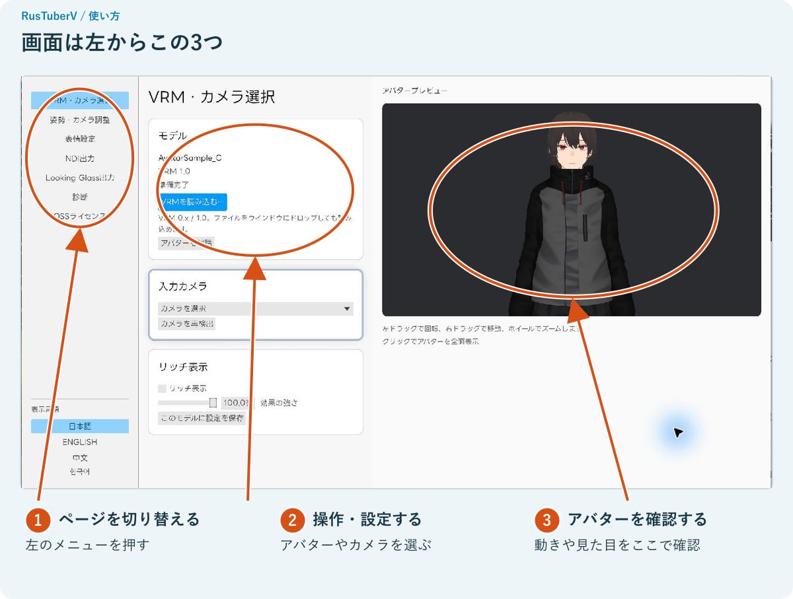
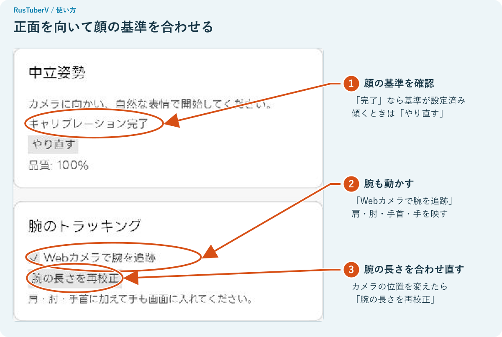
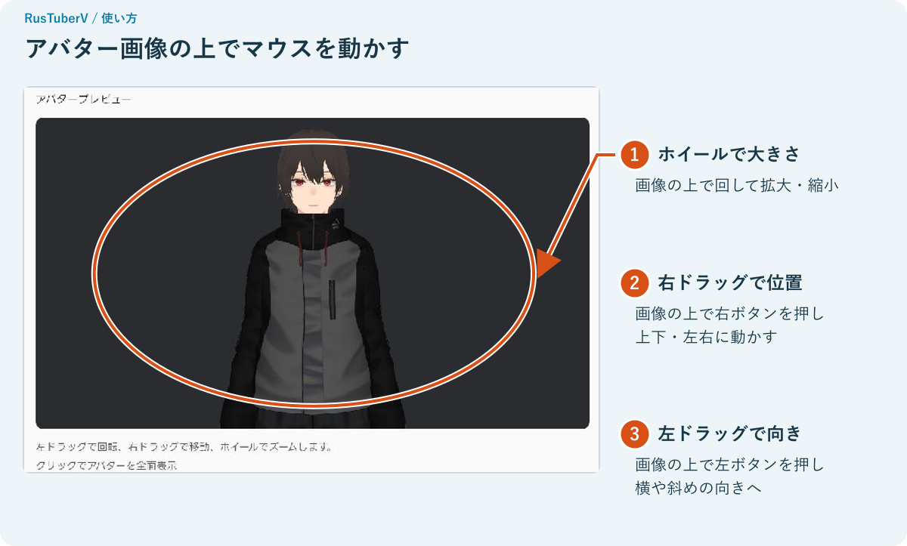
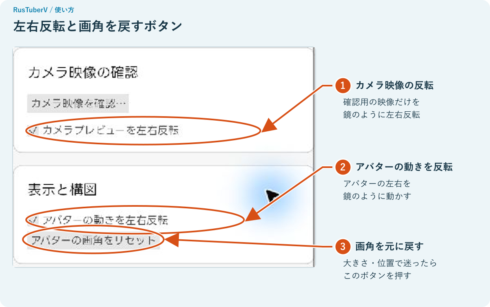
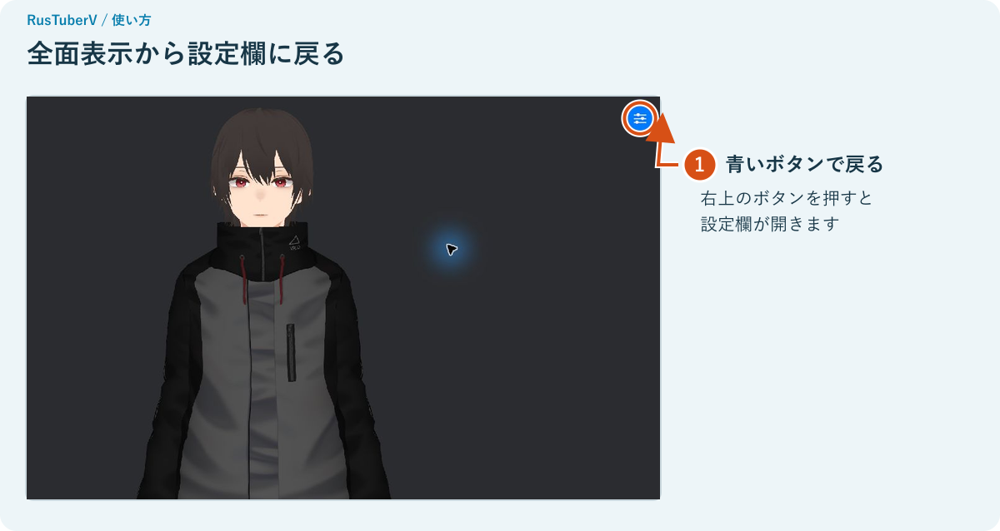
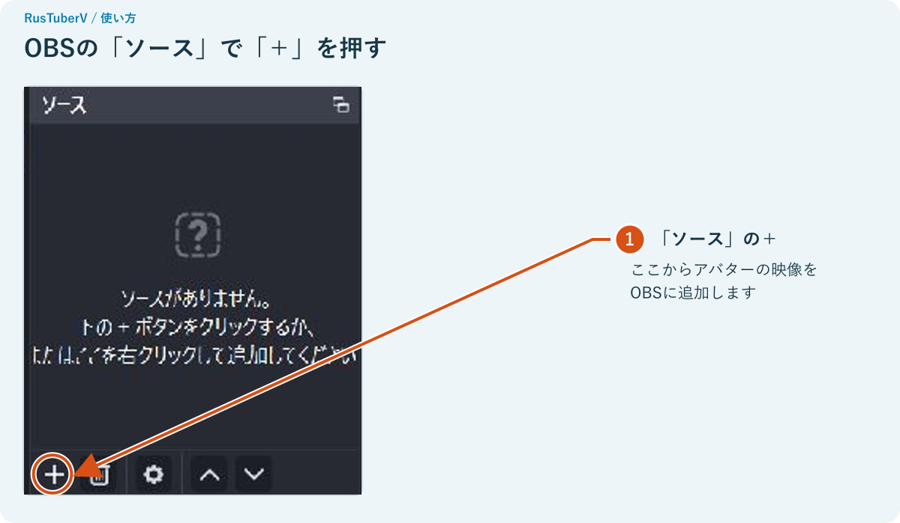
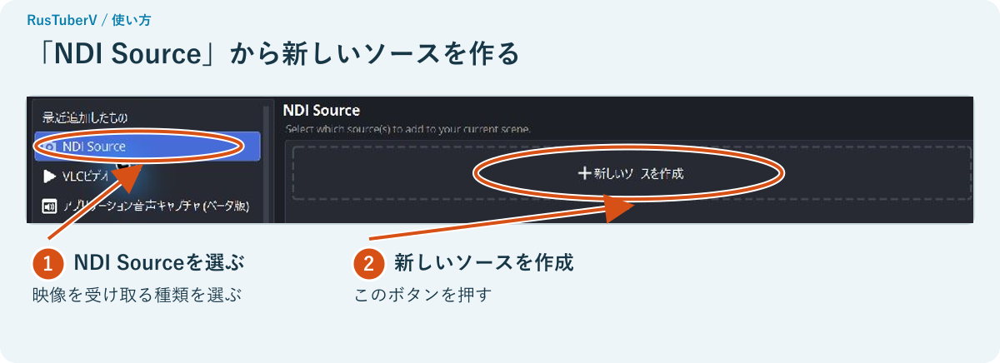
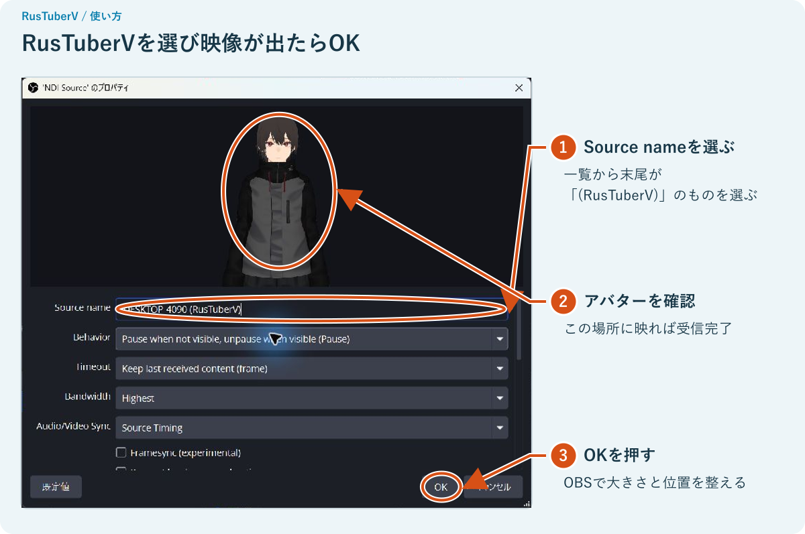

# RusTuberV 利用マニュアル

**日本語** · [English](../en/README.md) · [简体中文](../zh-CN/README.md) · [한국어](../ko/README.md)

Webカメラで顔や手の動きをVRMアバターに反映し、NDI・Spout2でOBSへ映像を送れます。表情と画角も調整できます。

設定は次の順で進めます。

| 手順 | 操作 | 確認・調整する内容 |
| --- | --- | --- |
| 1 | アバターの読み込み | 使用する`.vrm`ファイルを選びます |
| 2 | 入力カメラの選択 | カメラに顔や手が映る位置を確認します |
| 3 | 表情と画角の調整 | アバターの大きさ・位置・表情を調整します |
| 4 | OBSとの接続 | 配信に使う映像と音声を確認します |

**[起動と初期設定](#はじめる)** · **[姿勢と画角の調整](#映り方を整える)** · **[表情の切り替え](#表情を変える)** · **[OBSへの映像送信](#obsに映す)** · **[問題が起きたときの確認事項](#困ったとき)**

## 起動と初期設定

### 必要な機材とファイル

| 用意するもの | 使い道 |
| --- | --- |
| RusTuberVのアプリ一式 | アバターを表示する |
| アバターの `.vrm` ファイル | 自分の姿として使う。VRM 0.x・1.0に対応 |
| Webカメラ | 顔や手の動きを映す。パソコン内蔵のカメラでも使えます |

配信や録画をする場合は、[OBS Studio](https://obsproject.com/)も用意します。OBSの準備前にRusTuberVで動きを試せます。

### アプリの起動

Windowsでは、アプリのフォルダーにある **RusTuberV.exe** をダブルクリックします。ZIPで受け取った場合は、右クリックして **`「すべて展開」`** してから開きます。

**フォルダーの中身をまとめた状態でRusTuberV.exeを実行してください。**

MacではZIPを展開し、RusTuberV.appをアプリケーションフォルダーへ移動して開きます。初回起動時の許可は、macOSの`「システム設定」`→`「プライバシーとセキュリティ」`→`「このまま開く」`で行います。

### 1. アバターの読み込み

**`「VRMを読み込む…」`** を押して、使いたい `.vrm` ファイルを選びます。

ファイルをアプリのウインドウへドラッグしても選べます。

利用条件の画面が出たら、中の欄を下へスクロールして内容を確認します。条件に合う使い方であることを確認できたら、下のチェックを入れて **`「読み込む」`** を押します。

右側にアバターが現れ、**`「準備完了」`** と表示されたら読み込み完了です。

### 2. 入力カメラの選択

左の **`「VRM・カメラ選択」`** で、**`「入力カメラ」`** の一覧から使うカメラを選びます。表示される名前はパソコンによって変わります。

カメラに顔を向け、まばたきや顔の向きを変えます。顔や手の動きがアバターに反映されることを確認します。

`「カメラを再検出」`で接続中のカメラを一覧に表示します。カメラを後から接続したときも使えます。

## 姿勢と画角の調整

### 中立姿勢の校正

左の **`「姿勢・カメラ調整」`** を開き、カメラの正面で自然な表情にします。アプリが最初に顔を検出すると、その向きが自動で基準になります。

正面を向いているときにアバターが傾く場合は、**`「中立姿勢」`→`「やり直す」`**を押します。顔の検出を待っている間は、カメラに顔を向けます。

腕と手を追跡するときは、肩・肘・手首・手が映るようにカメラの位置を調整します。 `「Webカメラで腕を追跡」`のチェックを入れます。カメラの位置を変えたあとの校正には、`「腕の長さを再校正」`を押します。

### アバターの表示サイズ・位置・向き

右側のアバター画像の上で操作します。

| やりたいこと | 操作 |
| --- | --- |
| 大きく・小さくする | マウスのホイールを回します |
| 上下・左右へずらす | 右ボタンを押しながらドラッグします |
| 横や斜めから見る | 左ボタンを押しながらドラッグします |
| 最初の画角に戻す | `「姿勢・カメラ調整」`を下へスクロールし、`「アバターの画角をリセット」`を押します |

`「アバターの動きを左右反転」`を使うと、鏡を見ているように動きます。`「カメラプレビューを左右反転」`の対象は確認用のカメラ映像です。

### アバターの全面表示

右側のアバター画像を **一度クリック** すると、設定欄が閉じてアバターが全面に表示されます。右上の青いボタンを押すと、設定欄に戻ります。

### 腕と指の姿勢

腕の置き方を調整したいときは、`「姿勢・カメラ調整」`の`「腕の姿勢」`を使います。`「腕下げ」`は腕を下げる量、`「指の曲げ」`は指を曲げる量です。少しずつ動かして右側の姿を確認します。

## 表情の切り替え

左の **`「表情設定」`** を開きます。キーの横には割り当てられた表情が表示されます。

**RusTuberVのウインドウを選んでから** キーを押します。

数字キーは、キーボードの上段にあるものを使います。

| 操作 | 結果 |
| --- | --- |
| 割り当てられたキーを押す | その表情に切り替わります |
| 同じキーをもう一度押す | その表情を解除します |
| スペース、またはEscを押す | 標準の表情に戻ります |

キーの横の一覧を開くと、表情を選び直せます。表情の種類はアバターごとに違います。画面の例では`「1」`が笑顔です。

割り当てはアバターごとに保存されます。下までスクロールすると、**`「表情を解除」`** と **`「初期割り当てに戻す」`** があります。

### アバターの見た目と表情

髪や肌の色、質感にはVRMに保存されたマテリアルを使います。まばたきや口の動き、キーで切り替える表情は、モデルに用意された表情に従って表示されます。

## OBSへの映像送信

左の`「NDI・Spout2出力」`で、背景透過のアバター映像を送信します。プレビューで調整した大きさ・位置・向きが出力にも反映されます。NDIとSpout2はそれぞれ開始・停止でき、同時に使えます。

| 使う場面 | 方式 | OBSに用意するもの |
| --- | --- | --- |
| 同じWindows PCのOBSへ送る | [Spout2](#spout2で送るwindows) | `OBS Spout2 plugin` |
| Windows・Macで、同じPCや同じネットワーク上のOBSへ送る | [NDI](#ndiで送るwindowsmac) | DistroAVと対応するNDI Runtime |

### Spout2の送信設定（Windows）

1. OBSを閉じ、[公式配布ページ](https://github.com/Off-World-Live/obs-spout2-plugin/releases)からOBSのバージョンに対応した`OBS Spout2 plugin`をインストールして、OBSを開き直します。
2. RusTuberVでアバターを読み込み、左の`「NDI・Spout2出力」`を開きます。
3. `「Spout2送信を開始」`を押し、`「RusTuberV: 送信中」`と表示されることを確認します。
4. OBSの`「ソース」`で`「＋」`→`「Spout2 Capture」`を追加し、送信元に`RusTuberV`を選びます。
5. Spout2 Captureの`「Composite Mode」`を`「Premultiplied Alpha」`に設定します。
6. OBSでアバターのソースを背景画像やゲーム画面より上に並べます。

OBSとRusTuberVは同じGPUで実行します。映像は1920×1080です。送信の再開やGPUの選択については、[Spout2の詳しい手順](../SPOUT2.md)を参照してください。

### NDIの送信設定（Windows・Mac）

OBSに[DistroAV](https://distroav.org/download)と対応するNDI Runtimeをインストールします。お使いのOS・OBSのバージョンに合うものを[公式の導入手順](https://github.com/DistroAV/DistroAV/wiki/1.-Installation)で確認し、インストール後にOBSを開き直してください。`「NDI Source」`がすでにある場合は、送信の操作へ進めます。

#### 1. RusTuberVでの送信操作

左の`「NDI・Spout2出力」`を開き、`「NDI送信を開始」`を押します。`「状態：送信中」`になったらOBSで受け取ります。

NDI®で背景透過のアバター映像を送信します。声はOBSでマイクを設定します。

#### 2. OBSでの受信設定

OBSの`「ソース」`にある`「＋」`を押します。

`「NDI Source」`→`「新しいソースを作成」`を選びます。作成名の確認が出た場合は、分かりやすい名前を付けて進めます。

`「Source name」`の一覧で、末尾に`「(RusTuberV)」`と付いたものを選びます。先頭のパソコン名は環境によって変わります。

確認画面にアバターが出たら`「OK」`を押します。OBSでソースを選び、赤い枠の角をドラッグして大きさを整えます。枠の内側をドラッグすると位置を変えられます。

背景画像やゲーム画面を重ねる場合は、OBSの`「ソース」`一覧でアバターを上、背景を下に並べます。

### 配信前の映像と音声の確認

- アバターが映り、顔や手の動きが反映されることを確認します。
- OBSでマイクを設定し、話すとメーターが動くことを確認します。
- OBSで短く録画して、映像と声を再生して確認します。

配信先の設定が済んだら、OBSで`「配信開始」`を押します。

### 配信・録画の終了手順

1. OBSで配信・録画を停止します。
2. RusTuberVの`「NDI・Spout2出力」`で、使用中の`「Spout2送信を停止」` `「NDI送信を停止」`を押します。
3. RusTuberVを閉じます。

NDI® is a registered trademark of Vizrt NDI AB.

## 問題が起きたときの確認事項

### 起動時のエラー

ZIPをすべて展開し、同梱ファイルをまとめたまま起動してください。Windows版で起動に失敗した場合はエラーダイアログに原因が表示されます。設定ファイルや管理用フォルダーの場所も表示されます。

`settings.toml`や`tracking_profile.toml`のエラーでは、表示されたファイルをバックアップし、TOMLの書式と設定のバージョンを確認してください。新しいバージョンのアプリで保存した設定には、対応するバージョンのアプリを使います。アクセス権のエラーでは、表示された場所の読み書き権限を確認してください。問い合わせにはアプリのバージョンとエラー全文を添えてください。

必要環境やMac版の初回起動については、[リリース説明](https://github.com/matsuvr/RusTuberV/releases/latest)を確認してください。

### 起動後の確認項目

| 確認する項目 | 操作 |
| --- | --- |
| カメラの選択 | 接続を確認して`「カメラを再検出」`を押します。他のアプリがカメラを使っている場合は閉じます。OSのカメラ利用許可も確認します |
| アバターの動き | VRMとカメラを選びます。`「診断」`で顔の状態を確認し、カメラに顔を向けます。顔が暗いときは照明を顔の前に置きます |
| 顔の検出 | カメラとの距離を調整し、顔が画面に収まるようにします |
| 正面の向き | `「姿勢・カメラ調整」`→`「中立姿勢」`→`「やり直す」`を押します |
| 腕・手の追跡 | `「Webカメラで腕を追跡」`を確認し、肩・肘・手首・手を画面に入れます。必要に応じて`「腕の長さを再校正」`を押します |
| アバターの表示範囲 | ホイールや右ドラッグで調整します。元の画角に戻すときは`「アバターの画角をリセット」`を押します |
| 表情キーの操作 | RusTuberVのウインドウを選びます。開いている一覧やファイル選択画面を閉じてからキーを押します |
| Spout2の受信 | `OBS Spout2 plugin`とOBSの対応バージョンを確認し、OBSとRusTuberVを同じGPUで実行します。送信元にRusTuberVを選びます |
| Spout2の背景透過 | Spout2 CaptureのComposite ModeをPremultiplied Alphaに設定します |
| NDIソースの追加 | DistroAVと必要なNDI Runtimeをインストールし、OBSを開き直します |
| NDIの送信元 | RusTuberVが`「送信中」`か確認し、OBSでSource nameの一覧を開き直します |
| NDIの受信数 | OBSでRusTuberVを選び、ソースを表示します。受信数は映像を受け取っている接続の数です |
| NDIランタイム | アプリ一式を同じフォルダーに置きます。NDIを使う場合は配布元が案内するランタイムを用意します |
| VRMの読み込み | ファイルの拡張子が`.vrm`であることを確認し、`「再読み込み」`を試します。別のアバターでも確認します |

### カメラ映像のプレビュー

`「姿勢・カメラ調整」`を下へスクロールし、**`「カメラ映像を確認…」`** を押します。内容を確認して`「確認して映像を表示」`を押すと、顔の位置を見られます。終わったら **`「カメラ映像を隠す」`**、またはEscで隠します。

**OBSでウインドウやデスクトップを取り込んでいると、この確認映像も映ります。** 配信・録画の前にOBSの画面を確認してください。[OBSのウインドウキャプチャは、選んだウインドウを取り込みます。](https://obsproject.com/kb/window-capture-sources)

## Looking Glassへの出力

Looking Glassを持っている場合は、アバターをその画面にも表示できます。

1. Looking Glassをつなぎ、Looking Glass Bridgeを起動します。
2. 左の **`「Looking Glass出力」`** を開きます。
3. 一覧から機器を選んで **`「出力開始」`** を押します。
4. 終わったら **`「出力停止」`** を押します。

機器の一覧は、接続とBridgeの起動を確認してから`「再検出」`で更新できます。

---

画面例：Windows版RusTuberV 0.1.0、OBS Studio 32.2.2。アバター：AvatarSample_C（pixiv VRoid Project）。アバターは各配布元の利用条件を確認して用意してください。
