# RusTuberV 사용 설명서

[日本語](../ja/README.md) · [English](../en/README.md) · [简体中文](../zh-CN/README.md) · **한국어**

웹캠으로 VRM 아바타를 움직이고 NDI와 Spout2로 OBS에 영상을 보냅니다. 이 설명서에서는 얼굴·손 추적, 표정과 구도 조정을 다룹니다.

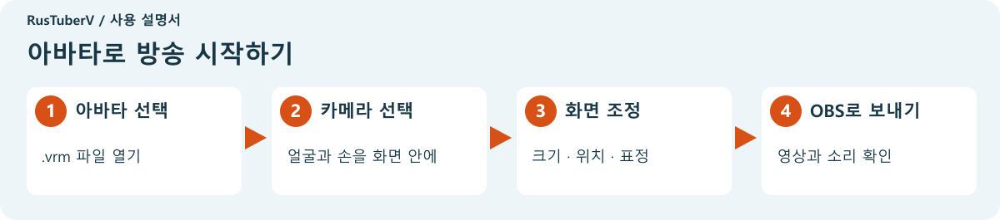

**[시작하기](#시작하기)** · **[화면 조정](#화면-조정)** · **[표정 바꾸기](#표정-바꾸기)** · **[OBS에 표시](#obs에-표시)** · **[문제 해결](#문제-해결)**

## 시작하기

### 준비물

| 준비물 | 용도 |
| --- | --- |
| RusTuberV 앱 폴더 전체 | 아바타 표시 |
| 아바타의 `.vrm` 파일 | 화면 속 나의 모습. VRM 0.x와 1.0 지원 |
| 웹캠 | 얼굴과 손의 움직임 촬영. 컴퓨터 내장 카메라도 사용 가능 |

방송이나 녹화를 하려면 [OBS Studio](https://obsproject.com/)도 준비하세요. 먼저 RusTuberV만으로 움직임을 확인해도 됩니다.

### 앱 열기

Windows에서는 앱 폴더의 **RusTuberV.exe**를 더블 클릭합니다. ZIP 파일로 받았다면 마우스 오른쪽 버튼을 눌러 **모두 압축 풀기**를 선택한 뒤 앱을 여세요.

**폴더 안의 파일은 함께 두세요.** 압축을 푼 폴더에서 RusTuberV.exe를 실행합니다.

Mac에서는 ZIP을 압축 해제하고 RusTuberV.app을 응용 프로그램 폴더로 옮겨 실행하세요. 처음 실행할 때는 시스템 설정 → 개인정보 보호 및 보안에서 앱 실행을 허용합니다.

왼쪽 아래의 **한국어**를 선택하면 이 설명서에 나오는 버튼 이름으로 표시됩니다.

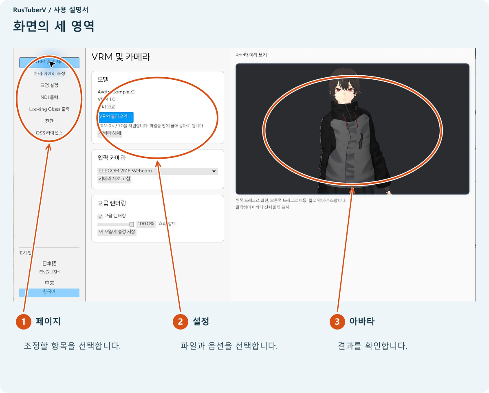

### 1. 아바타 선택

**VRM 불러오기…**를 눌러 사용할 `.vrm` 파일을 선택합니다.

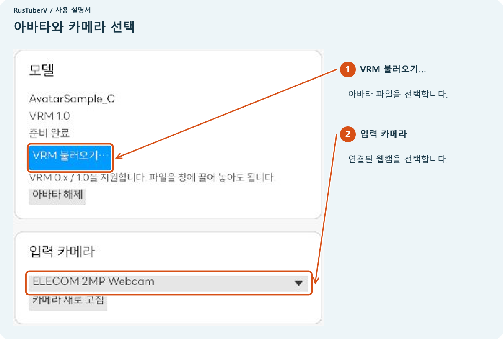

파일을 앱 창에 끌어 놓아도 선택할 수 있습니다.

라이선스 확인 화면이 나오면 내용 영역을 아래로 스크롤해 이용 조건을 읽습니다. 사용하려는 용도가 조건에 맞는지 확인한 뒤 아래 체크박스를 선택하고 **불러오기**를 누릅니다.

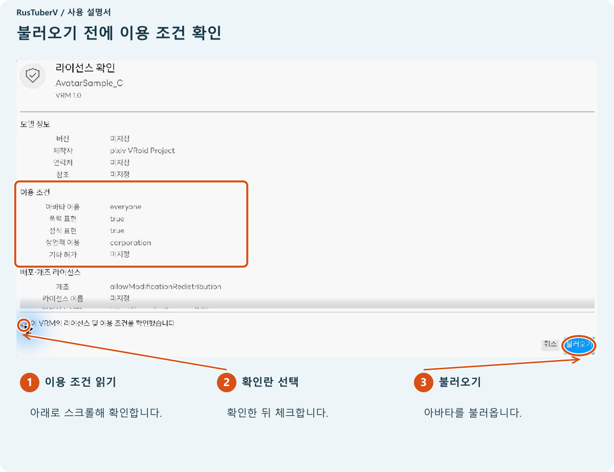

오른쪽에 아바타가 나타나고 **준비 완료**가 표시되면 불러오기가 끝난 것입니다.

### 2. 카메라 선택

왼쪽의 **VRM 및 카메라**에서 **입력 카메라** 목록을 열고 사용할 카메라를 선택합니다. 표시되는 이름은 컴퓨터마다 다릅니다.

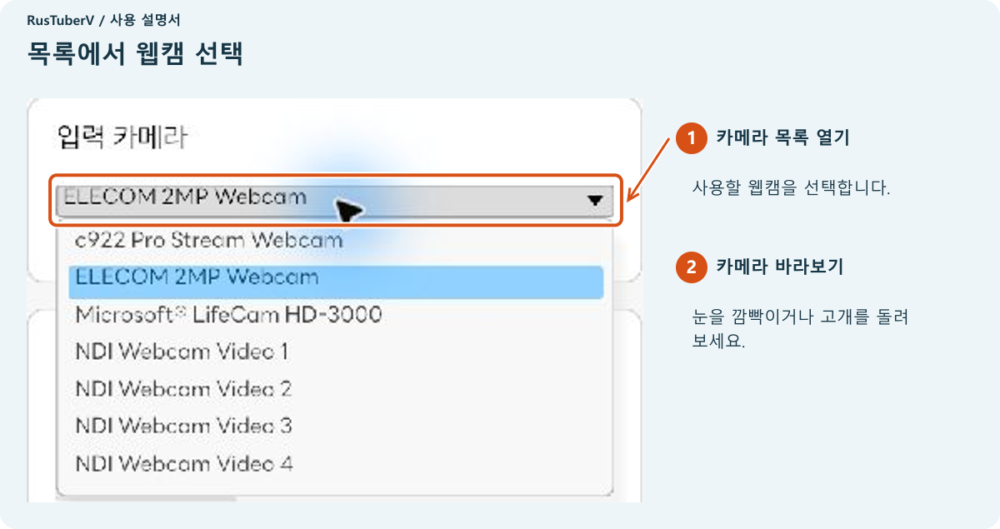

카메라를 바라보고 눈을 깜빡이거나 얼굴 방향을 바꿔 보세요. 얼굴과 손의 움직임이 아바타에 반영됩니다.

**카메라 새로 고침**으로 연결된 카메라 목록을 갱신합니다. 앱을 연 뒤 카메라를 연결했을 때도 사용합니다.

## 화면 조정

### 얼굴의 정면 맞추기

왼쪽의 **자세·카메라 조정**을 열고 카메라를 정면으로 바라보며 자연스러운 표정을 짓습니다. 처음 감지한 얼굴의 방향이 자동으로 기준이 됩니다.

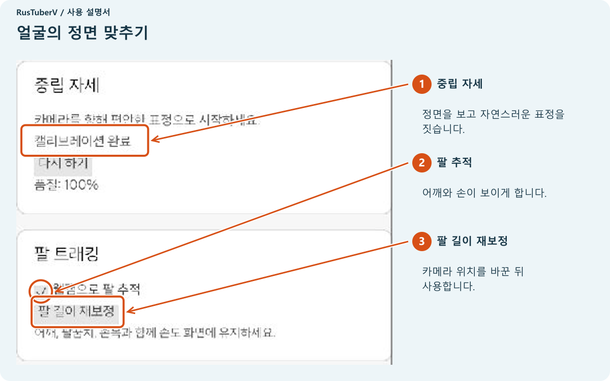

정면을 바라보는데 아바타가 기울어진다면 **중립 자세 → 다시 하기**를 누릅니다. 얼굴 감지를 기다리는 동안 카메라에 얼굴을 비추세요.

**손도 움직이려면 어깨·팔꿈치·손목·손이 모두 카메라에 보이게 하세요.** **웹캠으로 팔 추적**을 선택합니다. 카메라 위치를 바꾼 뒤 다시 보정하려면 **팔 길이 재보정**을 누릅니다.

### 크기와 위치 및 방향 조정

오른쪽 아바타 이미지 위에서 마우스를 조작합니다.

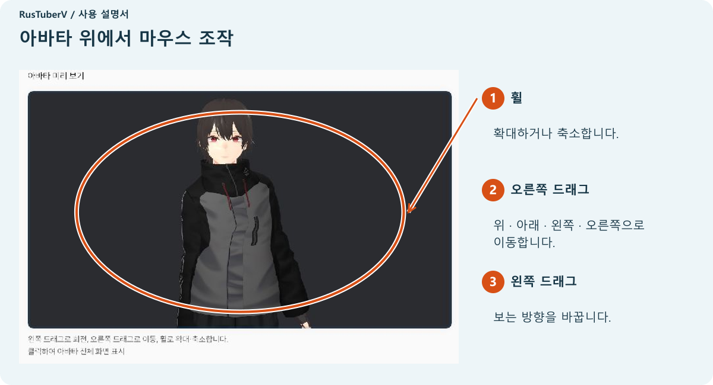

| 하고 싶은 작업 | 조작 |
| --- | --- |
| 크게 또는 작게 보기 | 마우스 휠 돌리기 |
| 위·아래·왼쪽·오른쪽으로 이동 | 오른쪽 버튼을 누른 채 드래그 |
| 옆이나 비스듬한 방향에서 보기 | 왼쪽 버튼을 누른 채 드래그 |
| 처음 구도로 돌아가기 | 자세·카메라 조정에서 아래로 스크롤 → 아바타 구도 초기화 |

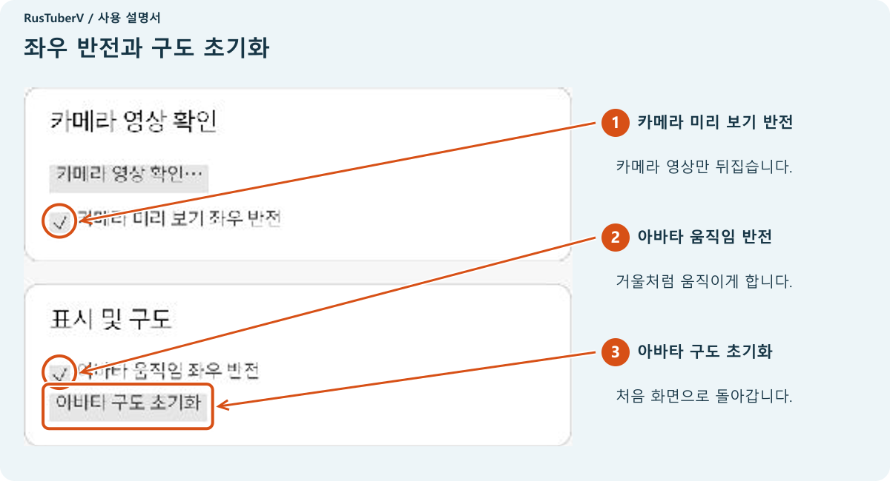

**아바타 움직임 좌우 반전**을 사용하면 거울을 보는 것처럼 움직입니다. **카메라 미리 보기 좌우 반전**은 위치 확인용 카메라 영상만 뒤집습니다.

### 아바타를 크게 표시

오른쪽 아바타 이미지를 **한 번 클릭**하면 설정 영역이 닫히고 아바타가 창 전체에 표시됩니다. 오른쪽 위의 파란 버튼을 누르면 설정 영역으로 돌아갑니다.

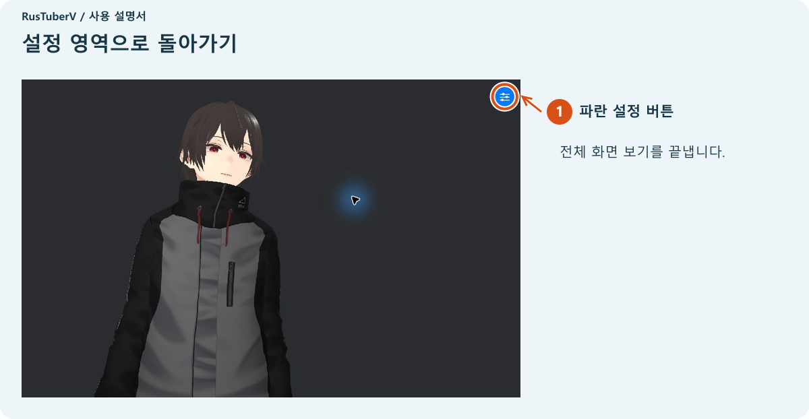

### 팔 자세 조정

팔을 두는 자세를 조절하려면 자세·카메라 조정의 **팔 자세**를 사용합니다. **팔 내리기**는 팔을 내리는 정도를, **손가락 굽힘**은 손가락을 구부리는 정도를 조절합니다. 조금씩 움직이며 오른쪽 모습을 확인하세요.

## 표정 바꾸기

왼쪽의 **표정 설정**을 엽니다. 각 키 옆에 해당 키로 선택할 표정이 표시됩니다.

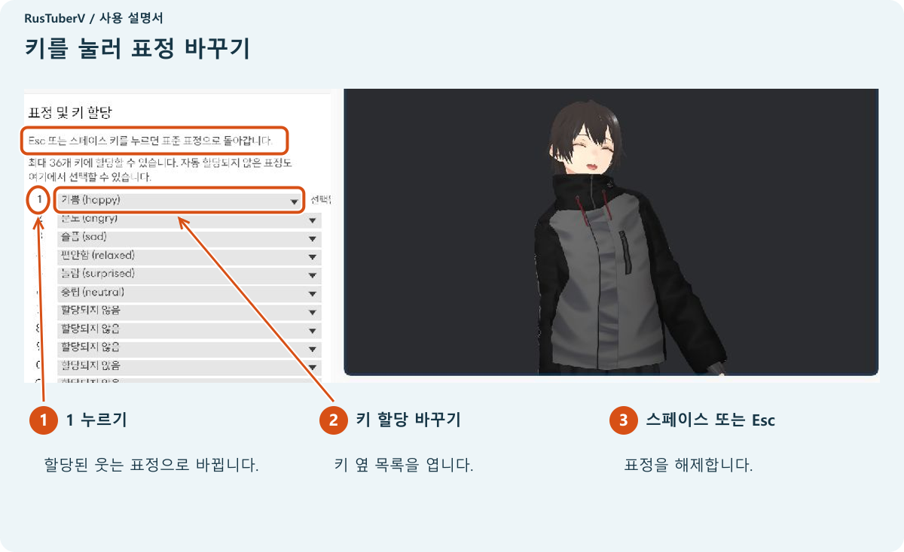

**RusTuberV 창을 선택한 뒤** 키를 누릅니다. 숫자 키는 키보드 맨 위 줄에 있는 키를 사용하세요.

| 조작 | 결과 |
| --- | --- |
| 할당된 키 누르기 | 해당 표정 선택 |
| 같은 키 다시 누르기 | 해당 표정 해제 |
| 스페이스 또는 Esc 누르기 | 표준 표정으로 돌아가기 |

키 옆 목록을 열면 표정을 다시 고를 수 있습니다. 사용할 수 있는 표정은 아바타마다 다릅니다. 화면 예시에서는 **1**이 웃는 표정입니다.

키 할당은 아바타별로 저장됩니다. 맨 아래로 스크롤하면 **표정 해제**와 **기본 키 할당 복원**이 있습니다.

### 아바타의 외형과 표정

머리카락, 피부색과 질감에는 VRM에 저장된 머티리얼을 사용합니다. 눈 깜빡임, 입 움직임과 키보드 표정 전환은 모델에 준비된 표정으로 표시됩니다.

## OBS에 표시

**영상 출력**을 열어 투명 배경 아바타 영상을 전송합니다. 미리 보기에서 조정한 크기, 위치와 방향은 출력에도 반영됩니다. NDI와 로컬 출력(Windows의 Spout2 또는 Mac의 Syphon)은 각각 시작·중지할 수 있고 동시에 사용할 수도 있습니다.

| 사용 상황 | 방식 | OBS 준비 |
| --- | --- | --- |
| 같은 Windows PC의 OBS | [Spout2](#spout2로-전송windows) | OBS Spout2 plugin |
| 같은 Windows 또는 Mac 컴퓨터, 또는 같은 네트워크의 다른 컴퓨터에 있는 OBS | [NDI](#ndi로-전송windowsmac) | DistroAV와 해당 NDI Runtime |

### Spout2로 전송（Windows）

1. OBS를 닫고 [공식 배포 페이지](https://github.com/Off-World-Live/obs-spout2-plugin/releases)에서 OBS 버전에 맞는 OBS Spout2 plugin을 설치한 뒤 OBS를 다시 엽니다.
2. RusTuberV에서 아바타를 불러오고 **영상 출력**을 엽니다.
3. **Spout2 전송 시작**을 누르고 **RusTuberV: 전송 중**을 확인합니다.
4. OBS에서 **소스 목록 → ＋ → Spout2 Capture**를 추가하고 송신자로 `RusTuberV`를 선택합니다.
5. Spout2 Capture의 **Composite Mode**를 **Premultiplied Alpha**로 설정합니다.
6. OBS 소스 목록에서 아바타를 배경 이미지나 게임 화면보다 위에 배치합니다.

OBS와 RusTuberV는 같은 GPU로 실행합니다. 영상 해상도는 1920×1080입니다. GPU 선택과 전송 재개 방법은 [Spout2 설명서](../SPOUT2.md#한국어)를 참조하세요.

### Syphon으로 전송（Mac）

1. 아바타를 불러오고 **영상 출력**을 엽니다.
2. **Syphon 전송 시작**을 누르고 **RusTuberV: 전송 중**을 확인합니다.
3. 같은 Mac의 Syphon 지원 앱에서 `RusTuberV` 소스를 선택합니다.

Syphon은 1920×1080 투명 배경 영상을 보내며 NDI와 동시에 사용할 수 있습니다. **Syphon 전송 중지**를 누르면 전송을 마칩니다.

### NDI로 전송（Windows・Mac）

OBS용 [DistroAV](https://distroav.org/download)와 해당 NDI Runtime을 설치합니다. [공식 설치 안내](https://github.com/DistroAV/DistroAV/wiki/1.-Installation)에서 운영체제와 OBS 버전에 맞는 설치 파일을 확인하고 설치 후 OBS를 다시 여세요. **NDI 소스**가 이미 있다면 영상 전송으로 진행합니다.

#### 1. RusTuberV에서 영상 보내기

**영상 출력**을 열고 **NDI 전송 시작**을 누릅니다. 상태가 **전송 중**이 되면 OBS에서 받습니다.

NDI®로 투명 배경 아바타 영상을 보냅니다. 목소리는 OBS에서 마이크를 설정합니다.

#### 2. OBS에서 받기

OBS의 **소스 목록**에서 **＋**를 누릅니다.

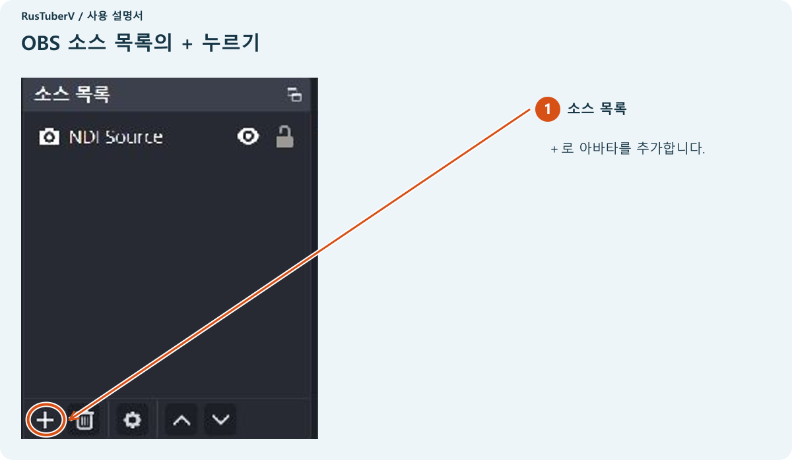

**NDI 소스 → 새 소스 생성**을 선택합니다. 이름을 묻는 화면이 나오면 알아보기 쉬운 이름을 지정하고 진행합니다.

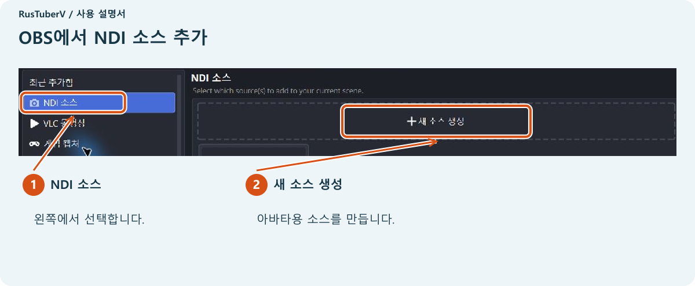

**소스이름** 목록에서 끝에 **(RusTuberV)**가 붙은 항목을 선택합니다. 앞부분의 컴퓨터 이름은 실행 환경에 따라 달라집니다.

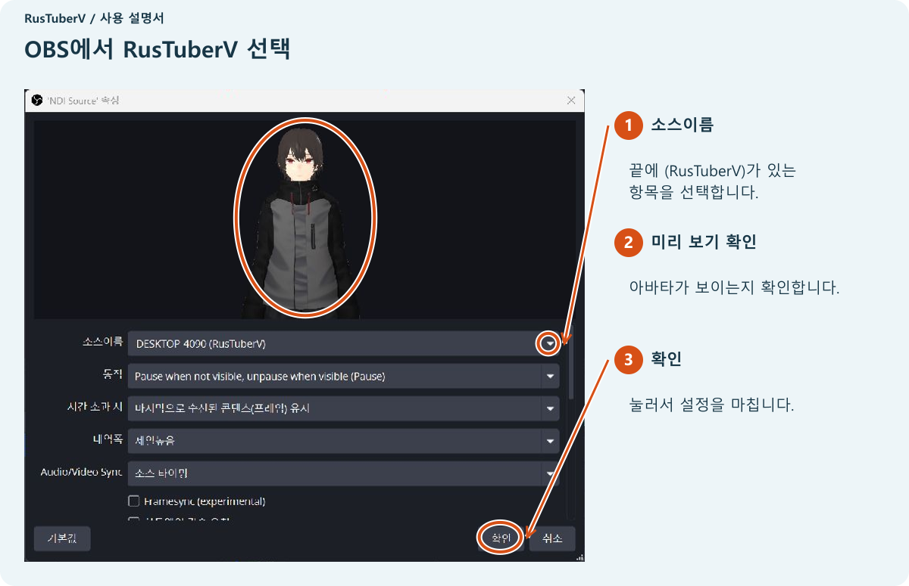

미리 보기에 아바타가 나타나면 **확인**을 누릅니다. OBS에서 소스를 선택하고 빨간 테두리의 모서리를 드래그해 크기를 조절하세요. 테두리 안쪽을 드래그하면 위치를 옮길 수 있습니다.

배경 이미지나 게임 화면을 겹치려면 OBS 소스 목록에서 아바타를 위에, 배경을 아래에 배치하세요.

### 방송 전 확인

- 아바타가 보이고 얼굴과 손의 움직임이 반영되는지 확인합니다.
- OBS에서 마이크를 설정하고 말할 때 미터가 움직이는지 확인합니다.
- OBS에서 짧게 녹화하고 재생해 영상과 소리를 확인합니다.

방송 플랫폼 설정이 끝났다면 OBS에서 **방송 시작**을 누릅니다.

### 끝낼 때

1. OBS에서 방송·녹화를 중지합니다.
2. RusTuberV의 **영상 출력**에서 사용 중인 **Syphon 전송 중지**, **Spout2 전송 중지**, **NDI 전송 중지**를 누릅니다.
3. RusTuberV를 닫습니다.

NDI® is a registered trademark of Vizrt NDI AB.

## 문제 해결

### 시작할 때 확인

ZIP 전체를 압축 해제하고 동봉된 파일을 함께 보관하세요. Windows에서는 시작 오류 대화 상자에 원인과 해당 설정 파일 또는 앱 관리 폴더의 경로가 표시됩니다.

`settings.toml` 또는 `tracking_profile.toml` 오류라면 표시된 파일을 백업하고 TOML 형식과 설정 버전을 확인하세요. 새 앱 버전에서 저장한 설정이라면 호환되는 앱 버전을 사용하세요. 접근 오류라면 표시된 경로의 읽기·쓰기 권한을 확인하세요. 문제를 문의할 때 앱 버전과 오류 전문을 함께 보내 주세요.

실행 환경과 Mac 최초 실행의 자세한 절차는 [릴리스 설명](https://github.com/matsuvr/RusTuberV/releases/latest)을 확인하세요.

### 실행 후 문제

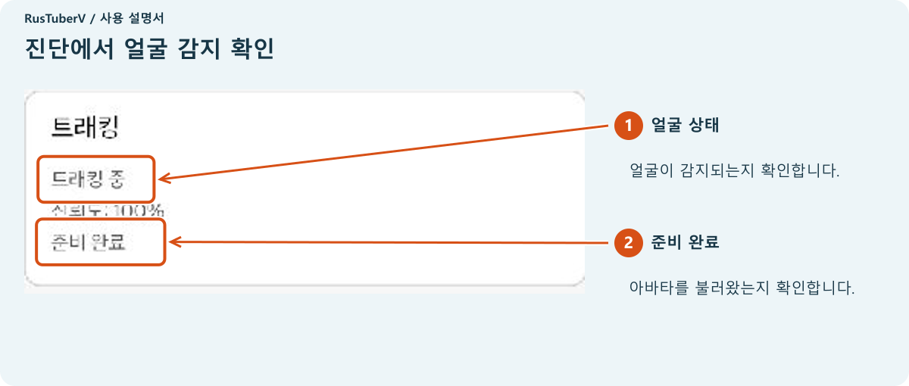

| 확인 항목 | 작업 |
| --- | --- |
| 카메라 선택 | 연결을 확인하고 카메라 새로 고침을 누릅니다. 다른 앱이 카메라를 사용한다면 닫고 OS 카메라 권한도 확인합니다 |
| 아바타 움직임 | VRM과 카메라를 선택합니다. 진단에서 얼굴 상태를 확인하고 카메라를 바라봅니다. 얼굴이 어둡다면 앞쪽에 조명을 둡니다 |
| 얼굴 감지 | 카메라와의 거리를 조절해 얼굴이 화면 안에 들어오게 합니다 |
| 정면에서도 기울어짐 | 자세·카메라 조정 → 중립 자세 → 다시 하기 |
| 팔과 손 추적 | 웹캠으로 팔 추적을 확인합니다. 어깨·팔꿈치·손목·손을 화면에 넣고 필요하면 팔 길이 재보정을 누릅니다 |
| 아바타가 작거나 잘림 | 휠이나 오른쪽 드래그로 조절합니다. 돌아가려면 아바타 구도 초기화를 누릅니다 |
| 표정 키 | RusTuberV 창을 선택합니다. 열린 목록이나 파일 선택 창을 닫은 뒤 키를 누릅니다 |
| Spout2 수신 | OBS와 플러그인의 버전 호환성을 확인하고 두 앱을 같은 GPU로 실행한 뒤 송신자로 RusTuberV를 선택합니다 |
| Spout2 투명 배경 | Spout2 Capture의 Composite Mode를 Premultiplied Alpha로 설정합니다 |
| NDI 소스 추가 | DistroAV와 필요한 NDI Runtime을 설치하고 OBS를 다시 엽니다 |
| NDI 송신자 선택 | RusTuberV가 전송 중인지 확인하고 소스이름 목록을 다시 엽니다 |
| 수신 수가 0으로 표시됨 | OBS에서 RusTuberV를 선택하고 소스를 표시합니다. 수신 수는 영상을 받는 연결의 수입니다 |
| NDI 런타임 | 앱 폴더의 파일을 함께 둡니다. NDI를 사용한다면 배포자가 안내하는 런타임을 준비합니다 |
| 불러오기 실패 | `.vrm` 파일인지 확인하고 다시 불러오기를 시도합니다. 다른 아바타도 확인합니다 |

### 자신의 카메라 영상 확인

**자세·카메라 조정**에서 아래로 스크롤하고 **카메라 영상 확인…**을 누릅니다. 안내를 읽고 **확인 후 영상 표시**를 누르면 얼굴 위치를 볼 수 있습니다. 끝나면 **카메라 영상 숨기기** 또는 Esc로 숨깁니다.

**OBS에서 앱 창이나 데스크톱을 캡처하고 있다면 이 카메라 영상도 캡처됩니다.** 방송·녹화 전에 OBS 화면을 확인하세요. [OBS 윈도우 캡처는 선택한 창을 캡처합니다.](https://obsproject.com/kb/window-capture-sources)

## Looking Glass에 표시

Looking Glass가 있다면 아바타를 해당 화면에도 표시할 수 있습니다.

1. Looking Glass를 연결하고 Looking Glass Bridge를 실행합니다.
2. 왼쪽의 **Looking Glass 출력**을 엽니다.
3. 목록에서 기기를 선택하고 **출력 시작**을 누릅니다.
4. 끝나면 **출력 중지**를 누릅니다.

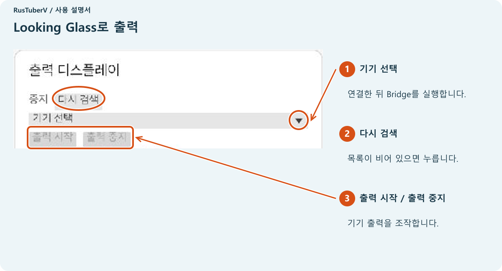

연결과 Bridge 실행 상태를 확인한 뒤 **다시 검색**을 누르면 기기 목록을 갱신할 수 있습니다.

---

화면 예시: Windows용 RusTuberV 0.1.0 및 OBS Studio 32.2.2. 아바타: AvatarSample_C(pixiv VRoid Project). 아바타는 배포처에서 구하고 해당 이용 조건에 따라 사용하세요.

[프로젝트README](../../README.ko.md)
