# RusTuberV 사용 설명서

[日本語](../ja/README.md) · [English](../en/README.md) · [简体中文](../zh-CN/README.md) · **한국어**

웹캠 앞에서 말하고 웃고 손을 움직여 보세요. 아바타를 움직여 OBS에 띄워 봅시다.

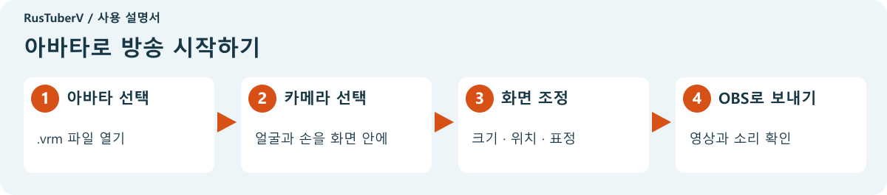

**[시작하기](#시작하기)** · **[화면 조정](#화면-조정)** · **[표정 바꾸기](#표정-바꾸기)** · **[OBS에 표시](#obs에-표시)** · **[문제 해결](#문제-해결)**

## 시작하기

### 준비물

| 준비물 | 용도 |
| --- | --- |
| RusTuberV 앱 폴더 전체 | 아바타 표시 |
| 아바타의 `.vrm` 파일 | 화면 속 나의 모습. VRM 0.x와 1.0 지원 |
| 웹캠 | 얼굴과 손의 움직임 촬영. 컴퓨터 내장 카메라도 사용 가능 |

방송이나 녹화를 하려면 [OBS Studio](https://obsproject.com/)도 준비하세요. 먼저 RusTuberV만으로 움직임을 확인해도 됩니다.

### 앱 열기

Windows에서는 앱 폴더의 **RusTuberV.exe**를 더블 클릭합니다. ZIP 파일로 받았다면 마우스 오른쪽 버튼을 눌러 **모두 압축 풀기**를 선택한 뒤 앱을 여세요.

**폴더 안의 파일은 함께 두세요.** RusTuberV.exe만 다른 곳으로 옮기지 말고 원래 폴더에서 실행합니다.

왼쪽 아래의 **한국어**를 선택하면 이 설명서에 나오는 버튼 이름으로 표시됩니다.

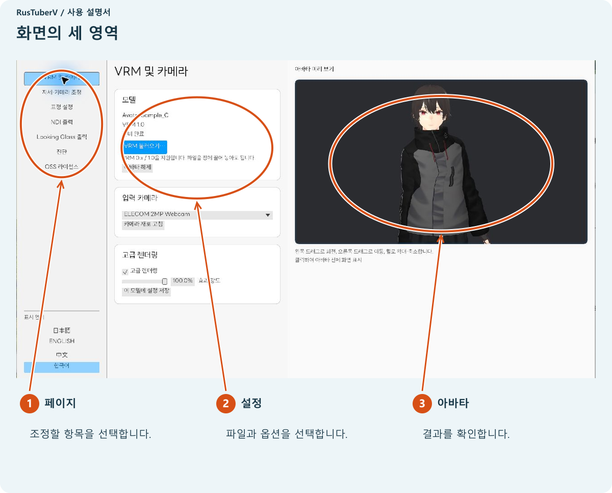

### 1. 아바타 선택

**VRM 불러오기…**를 눌러 사용할 `.vrm` 파일을 선택합니다.

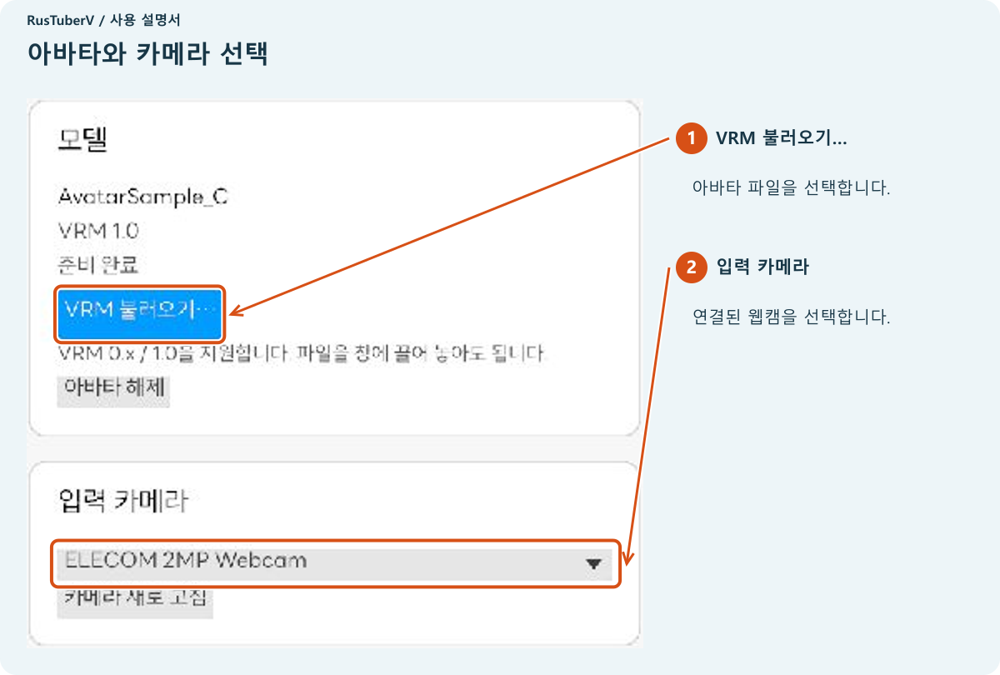

파일을 앱 창에 끌어 놓아도 선택할 수 있습니다.

라이선스 확인 화면이 나오면 내용 영역을 아래로 스크롤해 이용 조건을 읽습니다. 사용하려는 용도가 조건에 맞는지 확인한 뒤 아래 체크박스를 선택하고 **불러오기**를 누릅니다.

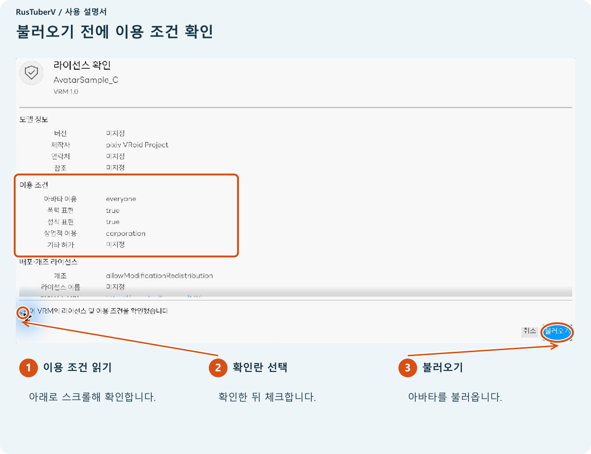

오른쪽에 아바타가 나타나고 **준비 완료**가 표시되면 불러오기가 끝난 것입니다.

### 2. 카메라 선택

왼쪽의 **VRM 및 카메라**에서 **입력 카메라** 목록을 열고 사용할 카메라를 선택합니다. 표시되는 이름은 컴퓨터마다 다릅니다.

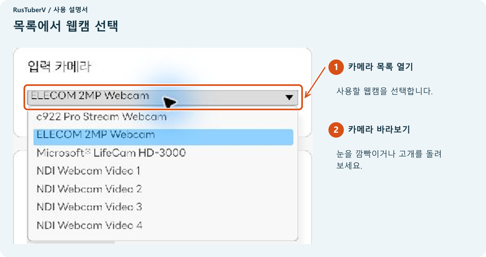

카메라를 바라보고 눈을 깜빡이거나 얼굴 방향을 바꿔 보세요. 실제 카메라 영상을 화면에 띄우지 않아도 아바타는 움직입니다.

**카메라가 보이지 않으면 카메라 새로 고침을 누르세요.** 앱을 연 뒤 카메라를 연결했을 때도 사용합니다.

## 화면 조정

### 얼굴의 정면 맞추기

왼쪽의 **자세·카메라 조정**을 열고 카메라를 정면으로 바라보며 자연스러운 표정을 짓습니다. 처음 감지한 얼굴의 방향이 자동으로 기준이 됩니다.

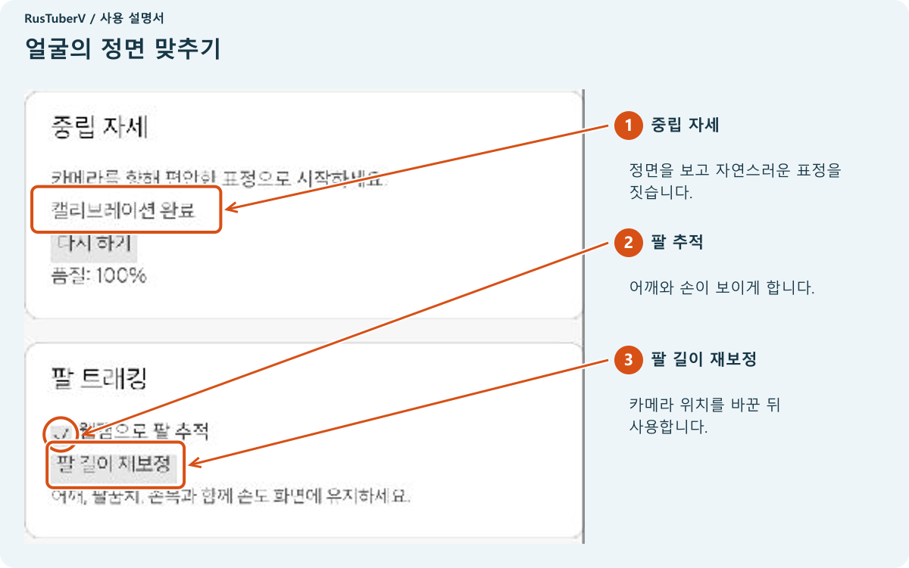

정면을 바라보는데 아바타가 기울어진다면 **중립 자세 → 다시 하기**를 누릅니다. 얼굴 감지를 기다리는 동안 카메라에 얼굴을 비추세요.

**손도 움직이려면 어깨·팔꿈치·손목·손이 모두 카메라에 보이게 하세요.** **웹캠으로 팔 추적**을 선택합니다. 카메라 위치를 바꾼 뒤 팔 움직임이 맞지 않으면 **팔 길이 재보정**을 누릅니다.

### 크기와 위치 및 방향 조정

오른쪽 아바타 이미지 위에서 마우스를 조작합니다.

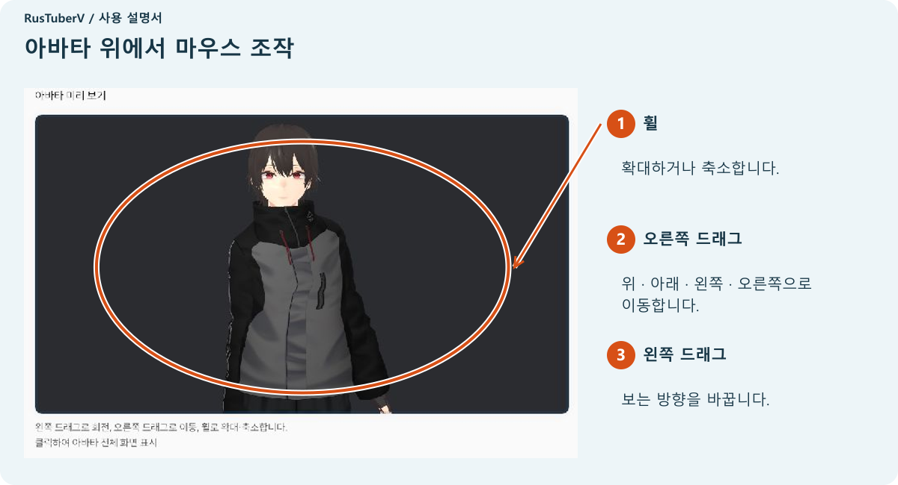

| 하고 싶은 작업 | 조작 |
| --- | --- |
| 크게 또는 작게 보기 | 마우스 휠 돌리기 |
| 위·아래·왼쪽·오른쪽으로 이동 | 오른쪽 버튼을 누른 채 드래그 |
| 옆이나 비스듬한 방향에서 보기 | 왼쪽 버튼을 누른 채 드래그 |
| 처음 구도로 돌아가기 | 자세·카메라 조정에서 아래로 스크롤 → 아바타 구도 초기화 |

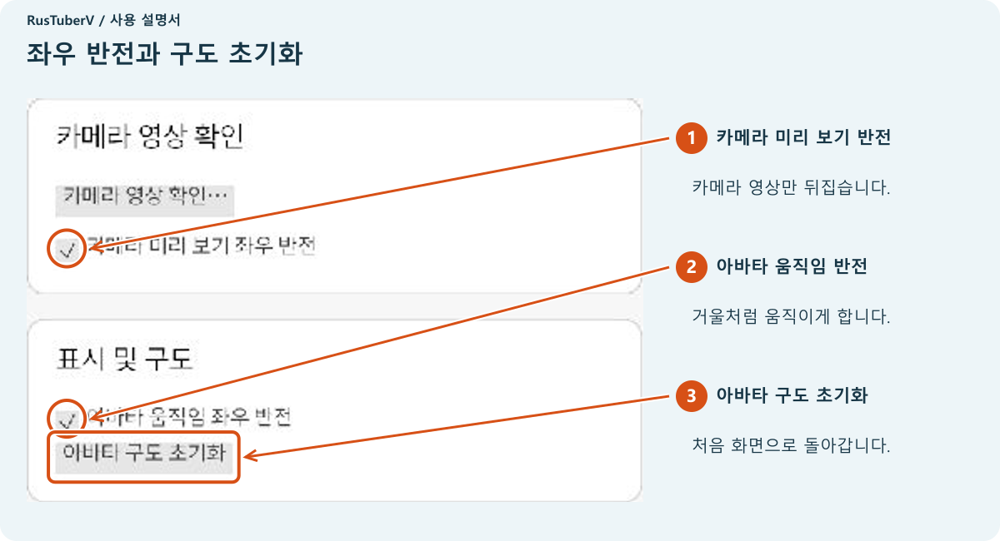

**아바타 움직임 좌우 반전**을 사용하면 거울을 보는 것처럼 움직입니다. **카메라 미리 보기 좌우 반전**은 위치 확인용 카메라 영상만 뒤집습니다.

### 아바타를 크게 표시

오른쪽 아바타 이미지를 **한 번 클릭**하면 설정 영역이 닫히고 아바타가 창 전체에 표시됩니다. 오른쪽 위의 파란 버튼을 누르면 설정 영역으로 돌아갑니다.

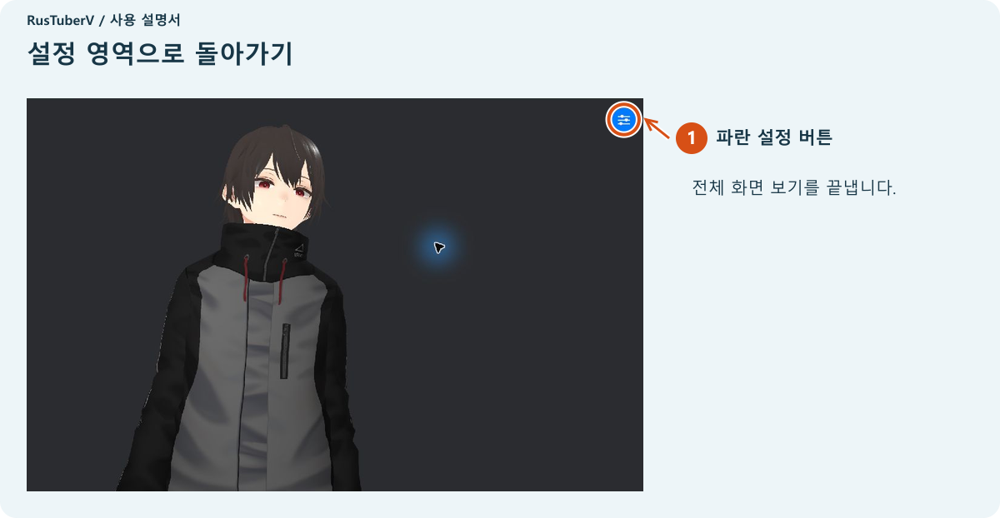

### 외형 조정

**VRM 및 카메라 → 고급 렌더링**을 선택하면 조명과 윤곽선 등의 표현이 바뀝니다. **효과 강도**를 원하는 정도로 조절하세요. **이 모델에 설정 저장**을 누르면 같은 아바타를 다시 불러올 때도 적용됩니다.

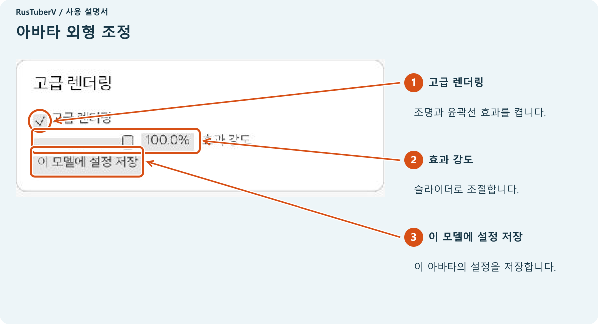

팔을 두는 자세를 조절하려면 자세·카메라 조정의 **팔 자세**를 사용합니다. **팔 내리기**는 팔을 내리는 정도를, **손가락 굽힘**은 손가락을 구부리는 정도를 조절합니다. 조금씩 움직이며 오른쪽 모습을 확인하세요.

## 표정 바꾸기

왼쪽의 **표정 설정**을 엽니다. 각 키 옆에 해당 키로 선택할 표정이 표시됩니다.

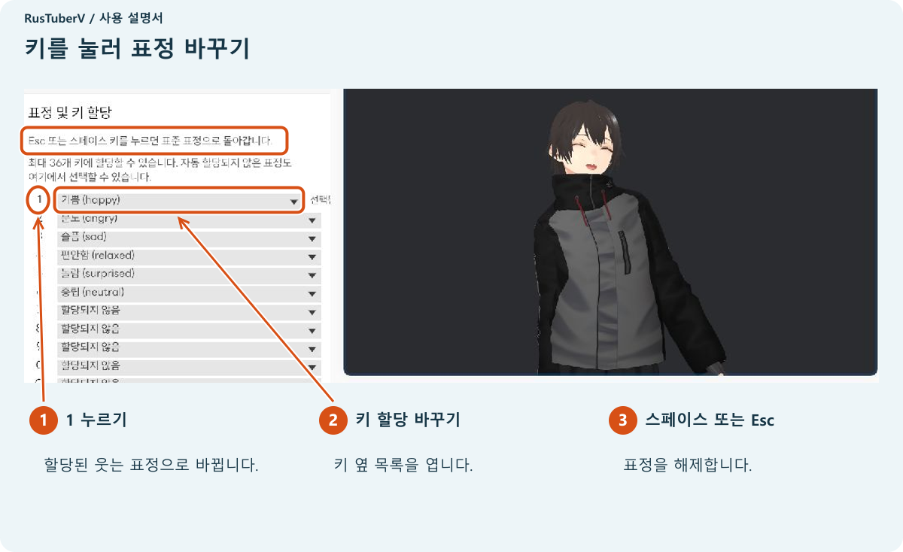

**RusTuberV 창을 선택한 뒤** 키를 누릅니다. 숫자 키는 키보드 맨 위 줄에 있는 키를 사용하세요.

| 조작 | 결과 |
| --- | --- |
| 할당된 키 누르기 | 해당 표정 선택 |
| 같은 키 다시 누르기 | 해당 표정 해제 |
| 스페이스 또는 Esc 누르기 | 표준 표정으로 돌아가기 |

키 옆 목록을 열면 표정을 다시 고를 수 있습니다. 사용할 수 있는 표정은 아바타마다 다릅니다. 화면 예시에서는 **1**이 웃는 표정입니다.

키 할당은 아바타별로 저장됩니다. 맨 아래로 스크롤하면 **표정 해제**와 **기본 키 할당 복원**이 있습니다.

## OBS에 표시

### 처음 한 번 준비

OBS에서 아바타 영상을 받으려면 **DistroAV**를 설치합니다. OBS에 **NDI 소스**가 이미 있다면 다음 단계로 넘어가세요.

1. OBS를 닫습니다.
2. [DistroAV 공식 다운로드 페이지](https://distroav.org/download)에서 운영체제에 맞는 버전을 설치합니다.
3. [공식 설치 안내](https://github.com/DistroAV/DistroAV/wiki/1.-Installation)에 따라 필요한 NDI Runtime도 설치합니다.
4. OBS를 다시 엽니다.

NDI는 아바타 영상을 OBS로 전달하는 기능입니다. [DistroAV는 OBS에 NDI 영상 수신 기능을 추가합니다.](https://github.com/DistroAV/DistroAV#distroav-features)

### 1. RusTuberV에서 영상 보내기

왼쪽의 **NDI 출력 → NDI 전송 시작**을 누릅니다. 상태가 **전송 중**이 되면 다음 단계로 넘어갑니다.

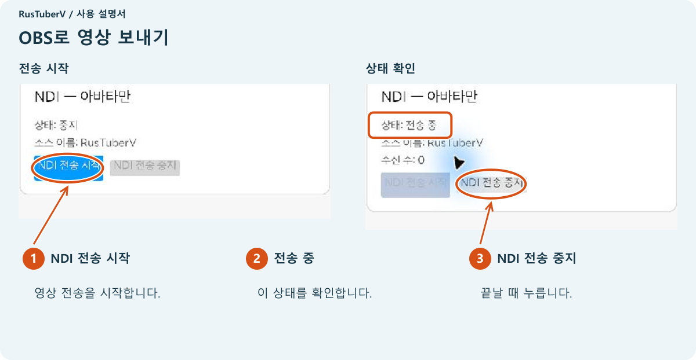

NDI로 보내는 것은 아바타 영상입니다. 설정 영역이나 위치 확인용으로 표시한 카메라 영상은 포함되지 않습니다.

### 2. OBS에서 받기

OBS의 **소스 목록**에서 **＋**를 누릅니다.

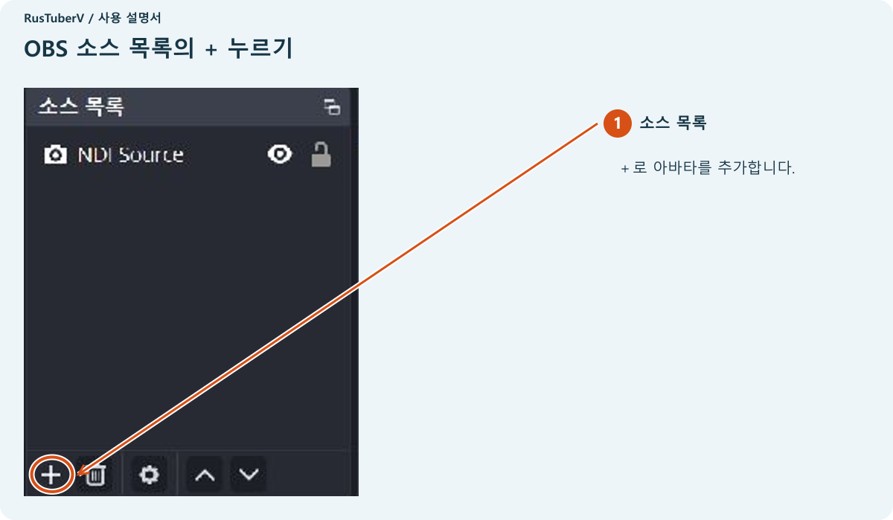

**NDI 소스 → 새 소스 생성**를 선택합니다. 이름을 묻는 화면이 나오면 알아보기 쉬운 이름을 지정하고 진행합니다.

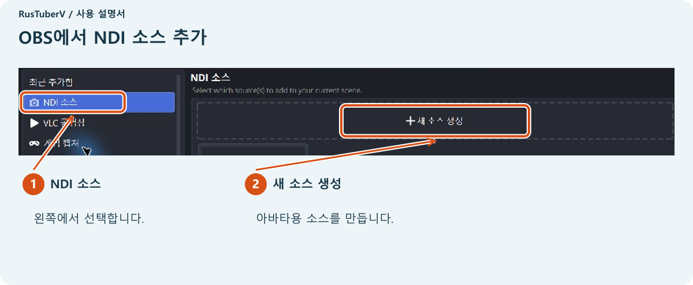

**소스이름** 목록에서 끝에 **(RusTuberV)**가 붙은 항목을 선택합니다. 앞부분의 컴퓨터 이름은 환경마다 다릅니다.

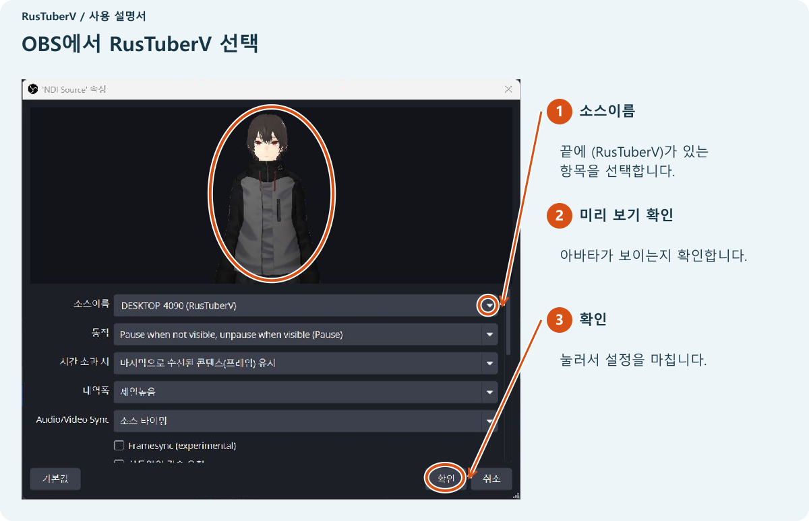

미리 보기에 아바타가 나타나면 **확인**를 누릅니다. OBS에서 소스를 선택하고 빨간 테두리의 모서리를 드래그해 크기를 조절하세요. 테두리 안쪽을 드래그하면 위치를 옮길 수 있습니다.

아바타 배경은 투명합니다. 배경 이미지나 게임 화면을 겹치려면 OBS 소스 목록에서 **아바타를 위에, 배경을 아래에** 배치하세요. 목소리는 OBS에서 마이크를 설정합니다.

### 방송 전 확인

- 아바타가 보이고 얼굴과 손의 움직임이 반영되는지 확인합니다.
- 말할 때 OBS 마이크 미터가 움직이는지 확인합니다.
- OBS에서 짧게 녹화하고 재생해 영상과 소리를 확인합니다.

방송 플랫폼 설정이 끝났다면 OBS에서 **방송 시작**을 누릅니다.

### 끝낼 때

**OBS에서 방송·녹화 중지 → RusTuberV에서 NDI 전송 중지 → 앱 닫기.**

**NDI 전송 중지**는 OBS로 영상을 보내는 기능을 멈춥니다. 방송과 녹화는 OBS에서 중지하세요.

## 문제 해결

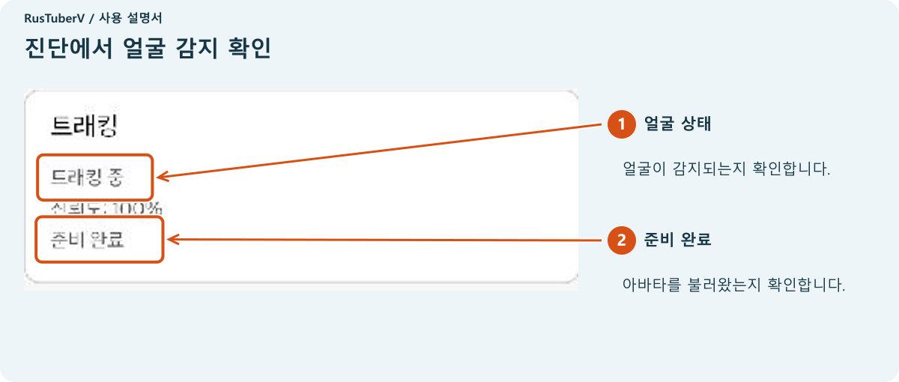

| 문제 | 시도할 작업 |
| --- | --- |
| 카메라가 목록에 없음 | 연결을 확인하고 카메라 새로 고침을 누릅니다. 다른 앱이 카메라를 사용한다면 닫고 OS 카메라 권한도 확인합니다 |
| 아바타가 움직이지 않음 | VRM과 카메라를 선택합니다. 진단에서 얼굴 상태를 확인하고 카메라를 바라봅니다. 얼굴이 어둡다면 앞쪽에 조명을 둡니다 |
| 얼굴을 찾지 못함 | 카메라와의 거리를 조절해 얼굴이 화면 안에 들어오게 합니다 |
| 정면에서도 기울어짐 | 자세·카메라 조정 → 중립 자세 → 다시 하기 |
| 손이 제대로 움직이지 않음 | 웹캠으로 팔 추적을 확인합니다. 어깨·팔꿈치·손목·손을 화면에 넣고 필요하면 팔 길이 재보정을 누릅니다 |
| 아바타가 작거나 잘림 | 휠이나 오른쪽 드래그로 조절합니다. 돌아가려면 아바타 구도 초기화를 누릅니다 |
| 표정 키가 작동하지 않음 | RusTuberV 창을 선택합니다. 열린 목록이나 파일 선택 창을 닫은 뒤 키를 누릅니다 |
| OBS에 NDI 소스가 없음 | DistroAV와 필요한 NDI Runtime을 설치하고 OBS를 다시 엽니다 |
| OBS 목록에 RusTuberV가 없음 | RusTuberV가 전송 중인지 확인하고 소스이름 목록을 다시 엽니다 |
| 수신 수가 0으로 표시됨 | OBS에서 RusTuberV를 선택하고 소스를 표시합니다. 수신 수는 영상을 받는 연결의 수입니다 |
| NDI 런타임을 찾지 못함 | 앱 폴더의 파일을 함께 둡니다. NDI를 사용한다면 배포자가 안내하는 런타임을 준비합니다 |
| 불러오기 실패 | `.vrm` 파일인지 확인하고 다시 불러오기를 시도합니다. 다른 아바타도 확인합니다 |

### 자신의 카메라 영상 확인

**자세·카메라 조정**에서 아래로 스크롤하고 **카메라 영상 확인…**을 누릅니다. 안내를 읽고 **확인 후 영상 표시**를 누르면 얼굴 위치를 볼 수 있습니다. 끝나면 **카메라 영상 숨기기** 또는 Esc로 숨깁니다.

**OBS에서 앱 창이나 데스크톱을 캡처하고 있다면 이 카메라 영상도 캡처됩니다.** 방송·녹화 전에 OBS 화면을 확인하세요. [OBS 윈도우 캡처는 선택한 창을 캡처합니다.](https://obsproject.com/kb/window-capture-sources)

## Looking Glass에 표시

Looking Glass가 있다면 아바타를 해당 화면에도 표시할 수 있습니다.

1. Looking Glass를 연결하고 Looking Glass Bridge를 실행합니다.
2. 왼쪽의 **Looking Glass 출력**을 엽니다.
3. 목록에서 기기를 선택하고 **출력 시작**을 누릅니다.
4. 끝나면 **출력 중지**를 누릅니다.

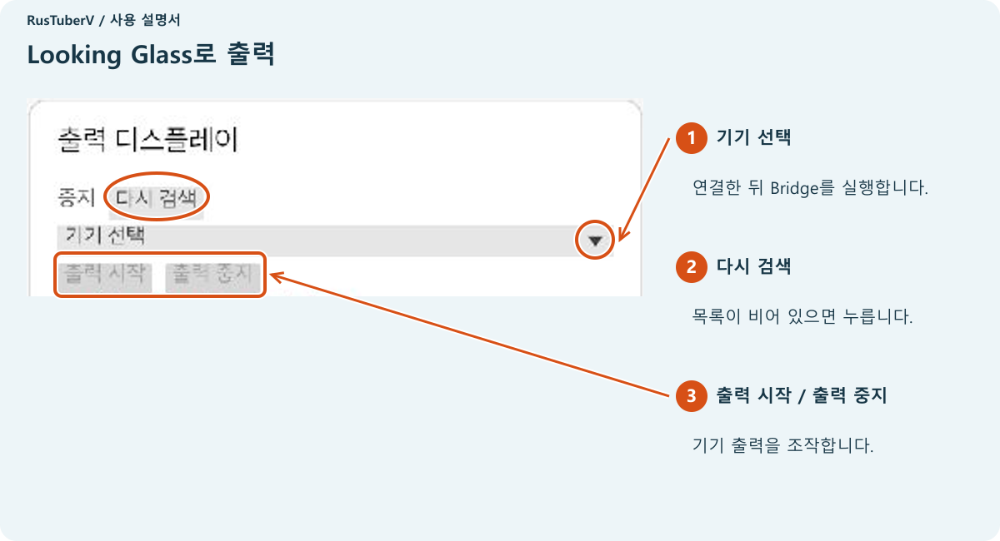

Looking Glass 기기가 검색되지 않으면 연결과 Bridge 실행 상태를 확인한 뒤 **다시 검색**을 누릅니다.

---

화면 예시: Windows용 RusTuberV 0.1.0 및 OBS Studio 32.2.2. 아바타: AvatarSample_C(pixiv VRoid Project). 이 설명서에는 아바타 파일이 포함되지 않습니다.

[프로젝트README](../../README.ko.md)
