# RusTuberV 使用手册

[日本語](../ja/README.md) · [English](../en/README.md) · **简体中文** · [한국어](../ko/README.md)

面对摄像头说话、微笑、动动双手。让虚拟形象跟着你动起来，再把它显示到 OBS 中。

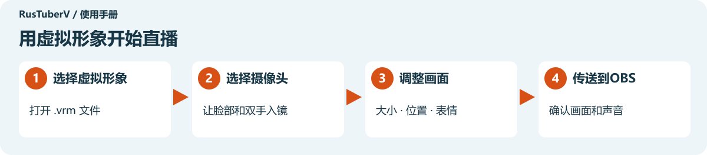

**[开始使用](#开始使用)** · **[调整画面](#调整画面)** · **[切换表情](#切换表情)** · **[在OBS中显示](#在obs中显示)** · **[遇到问题时](#遇到问题时)**

## 开始使用

### 准备这些东西

| 需要准备 | 用途 |
| --- | --- |
| 完整的 RusTuberV 应用文件夹 | 显示虚拟形象 |
| 虚拟形象的 `.vrm` 文件 | 作为你在画面中的角色。支持 VRM 0.x 和 1.0 |
| 摄像头 | 拍摄脸部和双手。电脑内置摄像头也可以 |

如果要直播或录制，请同时准备 [OBS Studio](https://obsproject.com/)。可以先只用 RusTuberV 试试动作。

### 打开应用

在 Windows 上，双击应用文件夹中的 **RusTuberV.exe**。如果收到的是 ZIP 文件，先右键选择 **“全部解压缩”**，再打开应用。

**请把文件夹内的文件放在一起。** 在原文件夹中运行 RusTuberV.exe，不要单独移走它。

点击左下角的 **“中文”**，即可使用本手册中的界面文字。

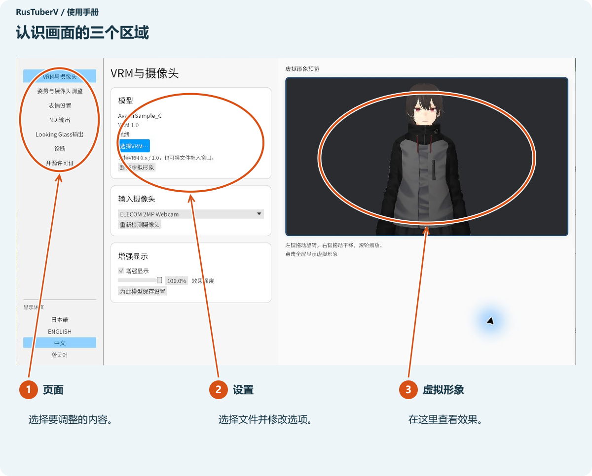

### 1. 选择虚拟形象

点击 **“选择VRM…”**，选择想使用的 `.vrm` 文件。

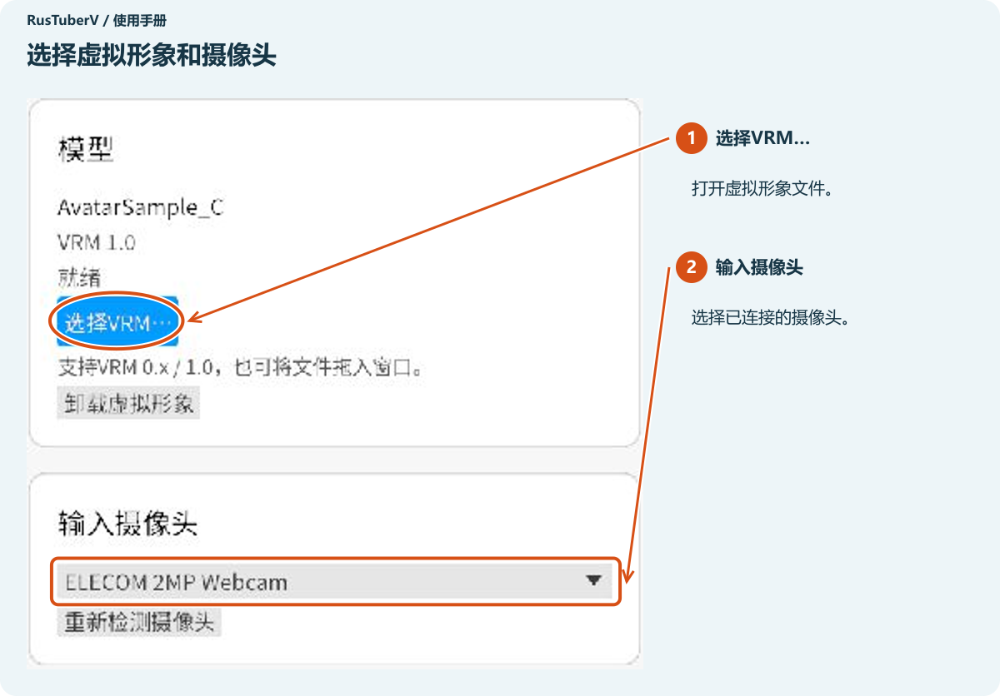

也可以把文件直接拖入应用窗口。

出现许可确认画面后，在内容栏内向下滚动并阅读使用条件。确认你的用途符合条件后，勾选底部的确认框，再点击 **“导入”**。

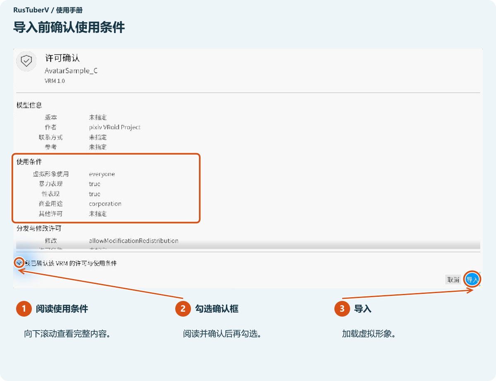

虚拟形象会出现在右侧。显示 **“就绪”** 后，加载就完成了。

### 2. 选择摄像头

打开左侧的 **“VRM与摄像头”**，从 **“输入摄像头”** 列表中选择要使用的摄像头。不同电脑上显示的名称可能不同。

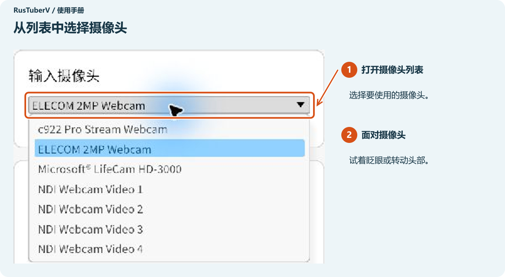

面对摄像头，试着眨眼或转动头部。即使不显示真实摄像头画面，虚拟形象也能跟着动。

**找不到摄像头时点击“重新检测摄像头”。** 在启动后才连接摄像头时，也可以使用它。

## 调整画面

### 对准正面

打开左侧的 **“姿势与摄像头调整”**，面对摄像头并保持自然表情。首次检测到脸部后，会自动将该朝向设为基准。

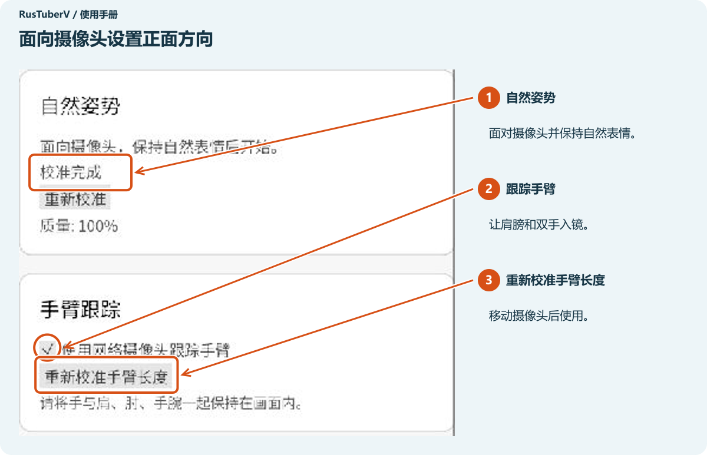

如果你面向正面时虚拟形象却倾斜，请选择 **“自然姿势”→“重新校准”**。等待检测脸部期间，请保持脸部在镜头内。

**想让双手也动起来，请让肩、肘、手腕和双手都入镜。** 勾选 **“使用网络摄像头跟踪手臂”**。移动摄像头后，如果手臂动作不再合适，点击 **“重新校准手臂长度”**。

### 调整大小、位置和角度

在右侧虚拟形象的图片上操作鼠标。

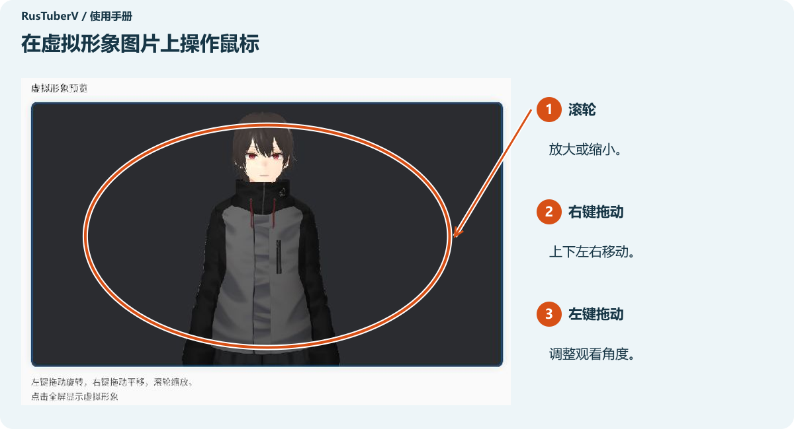

| 想做什么 | 操作 |
| --- | --- |
| 放大或缩小 | 转动鼠标滚轮 |
| 上下左右移动 | 按住鼠标右键拖动 |
| 从侧面或斜角查看 | 按住鼠标左键拖动 |
| 恢复初始构图 | 在姿势与摄像头调整中向下滚动，点击重置虚拟形象构图 |

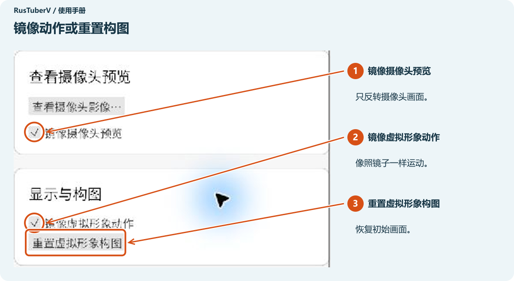

**“镜像虚拟形象动作”** 会让虚拟形象像照镜子一样运动。**“镜像摄像头预览”** 只反转用来确认位置的摄像头画面。

### 放大虚拟形象显示区域

在右侧虚拟形象图片上 **单击一次**，设置栏会收起，虚拟形象占满窗口。点击右上角的蓝色按钮，就能返回设置栏。

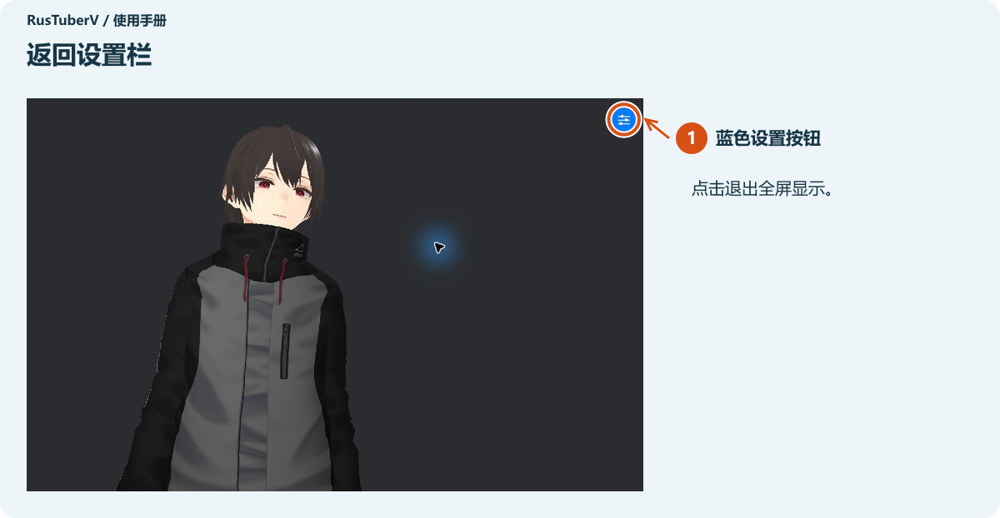

### 调整外观

勾选 **“VRM与摄像头”→“增强显示”**，光照和轮廓等效果会发生变化。用 **“效果强度”** 调整到喜欢的样子。点击 **“为此模型保存设置”** 后，下次加载同一个虚拟形象时也会使用这些设置。

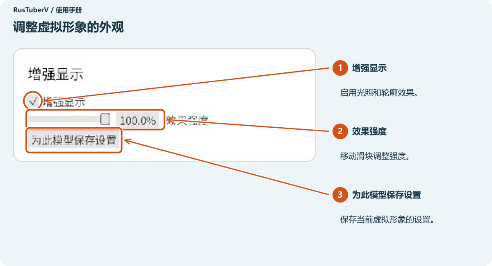

想调整手臂放置姿势时，使用“姿势与摄像头调整”中的 **“手臂姿势”**。“手臂下垂”控制手臂放下的程度，“手指弯曲”控制手指弯曲的程度。每次稍微移动滑块，并查看右侧的形象。

## 切换表情

打开左侧的 **“表情设置”**。每个按键旁边会显示它对应的表情。

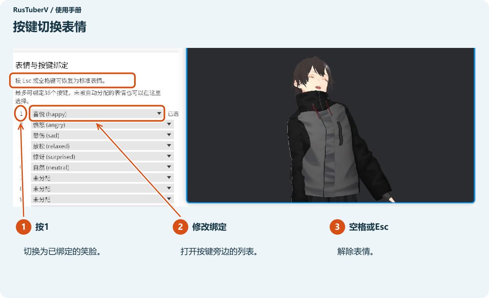

**先选中 RusTuberV 窗口，再按键。** 数字键请使用键盘最上面一排的按键。

| 操作 | 结果 |
| --- | --- |
| 按已绑定的按键 | 切换到对应表情 |
| 再按一次同一个按键 | 解除该表情 |
| 按空格或Esc | 返回标准表情 |

打开按键旁的列表，可以重新选择表情。可用表情因虚拟形象而异。图中的 **“1”** 对应笑脸。

按键绑定会按虚拟形象分别保存。滚动到底部，可以找到 **“取消表情”** 和 **“恢复默认绑定”**。

## 在OBS中显示

### 首次使用时准备一次

安装 **DistroAV**，让 OBS 接收虚拟形象视频。如果 OBS 中已经有 **“NDI 来源”**，可直接进行下一步。

1. 关闭 OBS。
2. 从 [DistroAV 官方下载页面](https://distroav.org/download)安装适合你操作系统的版本。
3. 按照[官方安装说明](https://github.com/DistroAV/DistroAV/wiki/1.-Installation)安装所需的 NDI Runtime。
4. 重新打开 OBS。

NDI 用于把虚拟形象视频传送到 OBS。[DistroAV 为 OBS 添加 NDI 视频接收功能。](https://github.com/DistroAV/DistroAV#distroav-features)

### 1. 从RusTuberV发送视频

打开左侧的 **“NDI输出”**，点击 **“开始NDI发送”**。状态变成 **“发送中”** 后，继续下一步。

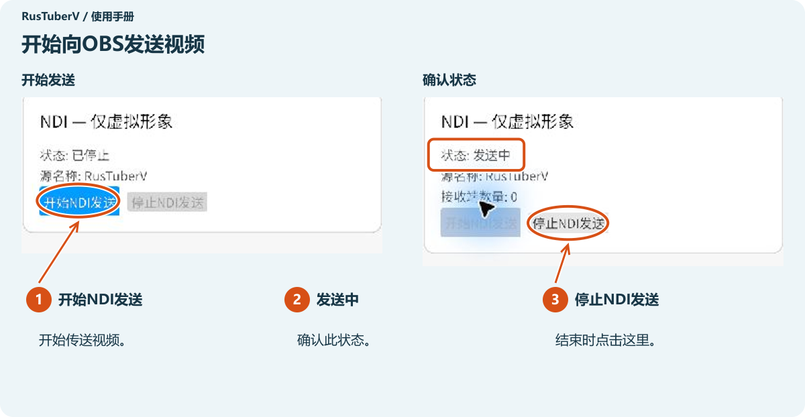

NDI 传送的是虚拟形象视频，不包含设置栏，也不包含为确认位置而显示的摄像头画面。

### 2. 在OBS中接收

点击 OBS **“源”** 栏的 **“＋”**。

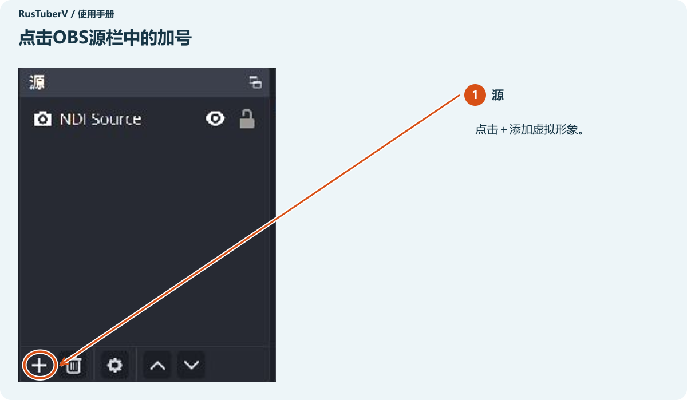

选择 **“NDI 来源”→“创建新源”**。如果出现名称输入框，取一个容易辨认的名称后继续。

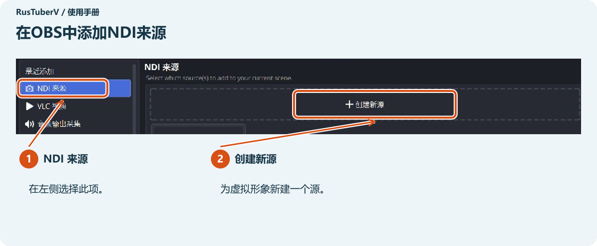

在 **“来源名称”** 列表中，选择名称末尾带有 **“(RusTuberV)”** 的项目。前面的电脑名称会因环境而异。

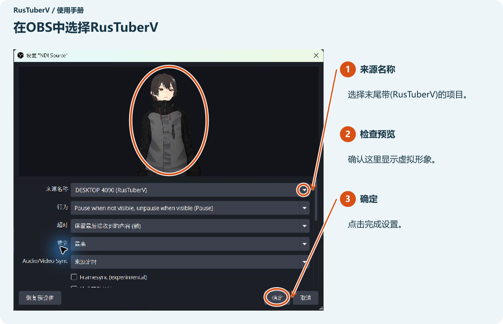

预览中出现虚拟形象后，点击 **“确定”**。在 OBS 中选中该来源，拖动红色边框的角来调整大小；拖动框内区域可调整位置。

虚拟形象的背景是透明的。要叠加背景图片或游戏画面，请在 OBS 源列表中把 **虚拟形象放在上面、背景放在下面**。声音请在 OBS 中设置麦克风。

### 直播前检查

- 虚拟形象已显示，脸部和双手动作能够反映到画面中。
- 说话时，OBS 的麦克风音量条会移动。
- 在 OBS 中录制一小段视频，播放确认画面和声音。

设置好直播平台后，在 OBS 中点击 **“开始直播”**。

### 结束时

**在OBS中停止直播或录制 → 在RusTuberV中点击“停止NDI发送” → 关闭应用。**

“停止NDI发送”用于停止向 OBS 传送视频。直播或录制需要在 OBS 中停止。

## 遇到问题时

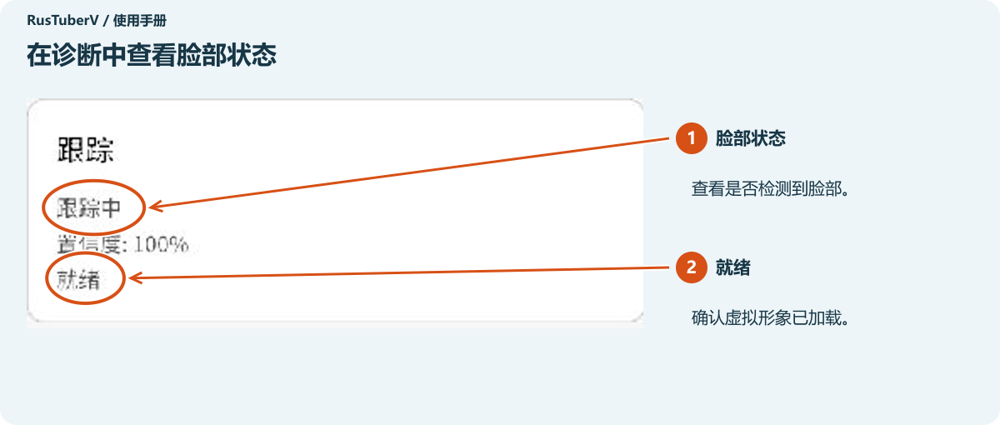

| 问题 | 可以尝试 |
| --- | --- |
| 列表中没有摄像头 | 检查连接后点击重新检测摄像头。关闭其他正在使用摄像头的应用，并检查操作系统的摄像头权限 |
| 虚拟形象不动 | 选择VRM和摄像头。在诊断中查看脸部状态并面对摄像头。脸部太暗时，把灯放在脸的前方 |
| 检测不到脸部 | 调整与摄像头的距离，让脸完整入镜 |
| 面向正面时仍然倾斜 | 使用姿势与摄像头调整 → 自然姿势 → 重新校准 |
| 双手动作不合适 | 检查使用网络摄像头跟踪手臂。让肩、肘、手腕和双手入镜。需要时重新校准手臂长度 |
| 虚拟形象太小或被裁切 | 使用滚轮或右键拖动调整。需要还原时点击重置虚拟形象构图 |
| 表情按键没有反应 | 先选中RusTuberV窗口。关闭展开的列表或文件选择窗口后再按键 |
| OBS没有NDI 来源 | 安装DistroAV及所需的NDI Runtime，然后重新打开OBS |
| OBS列表中没有RusTuberV | 确认RusTuberV显示发送中，然后重新展开来源名称列表 |
| 显示接收端数量为0 | 在OBS中选择RusTuberV并显示该来源。接收端数量表示正在接收视频的连接数 |
| 找不到NDI运行库 | 将应用文件夹中的文件放在一起。使用NDI时，请准备分发方指定的运行库 |
| 加载失败 | 确认文件是`.vrm`，再尝试重新加载。也可以用另一个虚拟形象测试 |

### 查看自己的摄像头画面

在 **“姿势与摄像头调整”** 中向下滚动，点击 **“查看摄像头影像…”**。阅读提示后，点击 **“确认并显示影像”**，即可查看脸部的位置。结束后点击 **“隐藏摄像头影像”**，或按 Esc 隐藏。

**如果OBS正在捕获应用窗口或整个桌面，这段摄像头画面也会被捕获。** 直播或录制前，请确认 OBS 中的画面。[OBS窗口捕获会捕获所选窗口。](https://obsproject.com/kb/window-capture-sources)

## 输出到Looking Glass

如果你有 Looking Glass，也可以把虚拟形象显示到该设备上。

1. 连接 Looking Glass，并启动 Looking Glass Bridge。
2. 打开左侧的 **“Looking Glass输出”**。
3. 从列表中选择设备，点击 **“开始输出”**。
4. 结束后点击 **“停止输出”**。

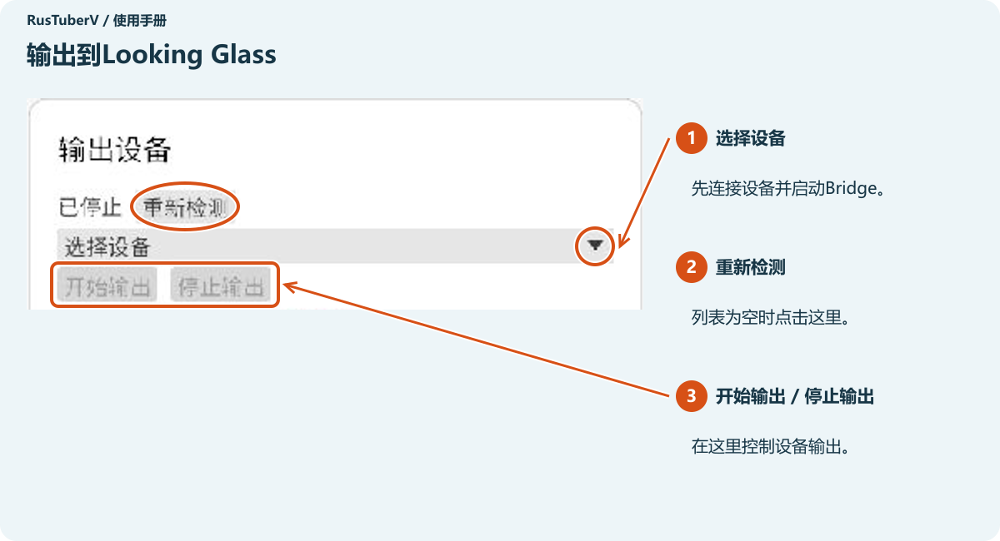

如果没有检测到 Looking Glass，请检查设备连接和 Bridge 是否已启动，再点击 **“重新检测”**。

---

画面示例：Windows版RusTuberV 0.1.0、OBS Studio 32.2.2。虚拟形象：AvatarSample_C（pixiv VRoid Project）。本手册不包含虚拟形象文件。

[项目README](../../README.zh-CN.md)
